<p align="center">
  
</p>

<h1 align="center">Tiho</h1>

<p align="center">
  <b>Live chat without the junk.</b><br>
  A free browser extension that hides spam, scam links and abuse in YouTube, Twitch and Kick chat.<br>
  A small AI model runs on your own computer. The chat never leaves it.<br>
  <sub>Early version · testing now · <a href="https://tiho.chat">tiho.chat</a></sub>
</p>

<p align="center">
  <a href="https://github.com/daradudai/tiho/actions/workflows/ci.yml"></a>
  <a href="LICENSE"></a>
  
  
</p>

<!-- docs/img/tiho-demo.gif and .mp4: node extension/tests/tools/media-shoot.mjs <Twitch popout chat url> clip
     --viewport 340x600 --trim 0.8 --clip-height 502 -->
<p align="center">
  
  <br><sub>Tiho on a live Twitch chat, 14 seconds (<a href="docs/img/tiho-demo.mp4">MP4</a>). Names are made up, see below.</sub>
</p>

<!-- docs/img/*.png are copies of extension/tests/ui/screenshots/ (node tests/ui/shoot.mjs):
     twitch-chill = chat-twitch-dark, youtube-reason = chat-youtube-light-hover, kick-chill = chat-kick-dark,
     twitch-focus = chat-twitch-light-focus, twitch-dashboard = chat-twitch-dark-open, popup = popup-dark,
     sidepanel-live = sidepanel-live-dark, sidepanel-log = sidepanel-log-dark -->
<table>
  <tr>
    <td align="center" width="25%"><br><sub><b>Twitch, Clean.</b> Toxic and scam hidden, spam folded, "KEKW ×37" wave, questions lit up.</sub></td>
    <td align="center" width="25%"><br><sub><b>YouTube.</b> Hover a message to see why it was tagged.</sub></td>
    <td align="center" width="25%"><br><sub><b>Kick.</b> Same bar, native look on each site.</sub></td>
    <td align="center" width="25%"><br><sub><b>Quiet.</b> One-word noise gone, complaints dimmed.</sub></td>
  </tr>
  <tr>
    <td align="center"><br><sub><b>Bar, expanded.</b> Rate, mood, categories, waves, latest questions.</sub></td>
    <td align="center"><br><sub><b>Popup.</b> Preset, strictness, model status.</sub></td>
    <td align="center"><br><sub><b>Side panel.</b> Live stats and per-category control.</sub></td>
    <td align="center"><br><sub><b>Log.</b> What was filtered and why. One click to undo.</sub></td>
  </tr>
</table>

<p align="center"><sub>These are renders of the real UI components on a mock chat (<code>extension/tests/ui/showcase</code>), not captures of live streams. Names and counts are sample data.</sub></p>

<!-- docs/img/live-*.png: node extension/tests/tools/media-shoot.mjs <channel url> <shots> (see its header) -->
<p align="center"><b>On live streams</b></p>
<table>
  <tr>
    <td align="center" width="25%">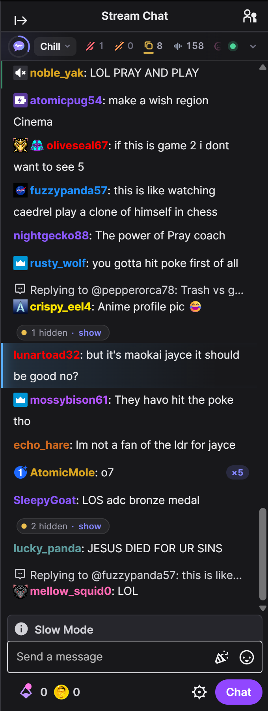<br><sub><b>Twitch.</b> Spam folded into pills, a question lit up, an "o7" wave counted ×5.</sub></td>
    <td align="center" width="25%">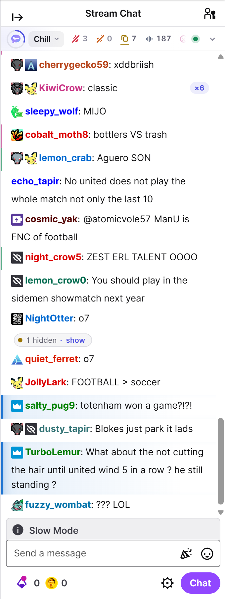<br><sub><b>Light theme.</b> The bar and the marks follow the site's theme.</sub></td>
    <td align="center" width="25%">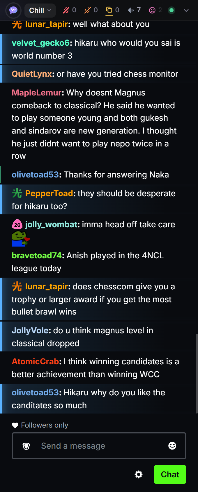<br><sub><b>Kick.</b> A chess stream: questions to the streamer stand out.</sub></td>
    <td align="center" width="25%">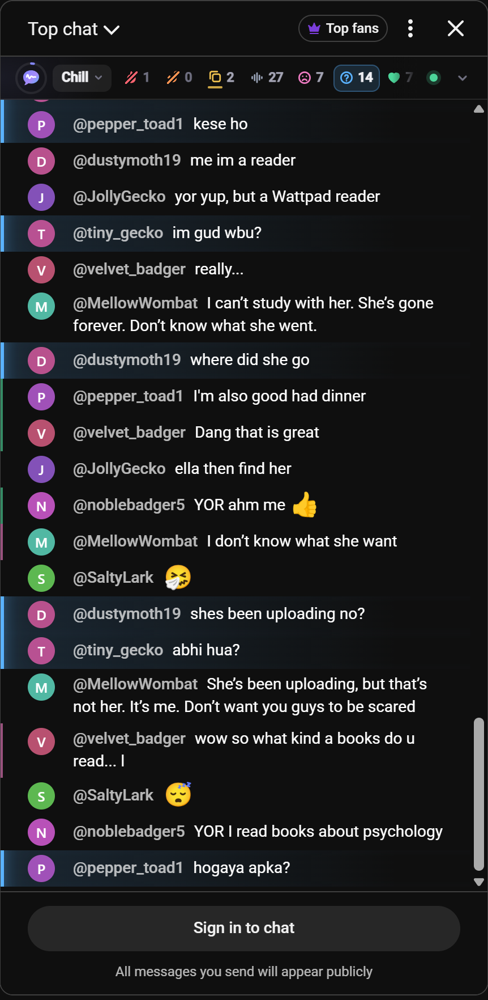<br><sub><b>YouTube.</b> Watch-page chat, questions in English and Hindi.</sub></td>
  </tr>
  <tr>
    <td align="center">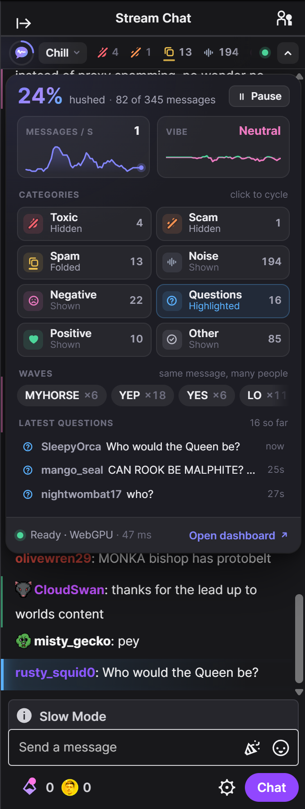<br><sub><b>Bar, expanded.</b> Rate, mood, waves, latest questions.</sub></td>
    <td align="center">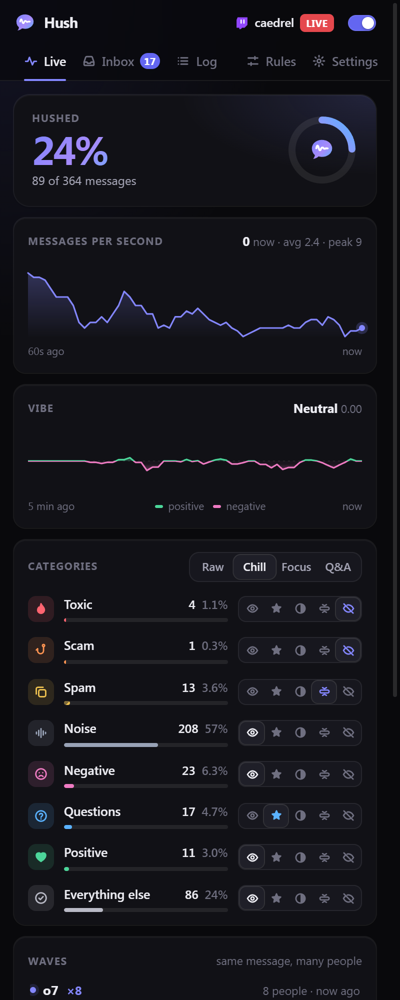<br><sub><b>Side panel.</b> Rate, mood and every category.</sub></td>
    <td align="center">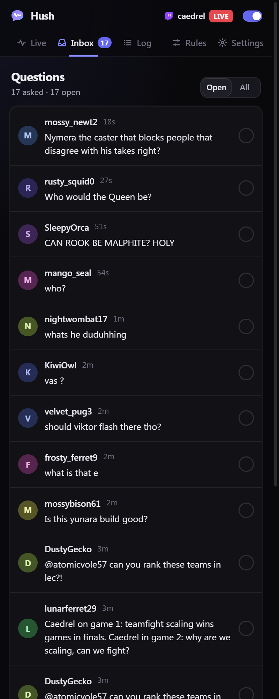<br><sub><b>Inbox.</b> Every question from chat in one list.</sub></td>
    <td align="center">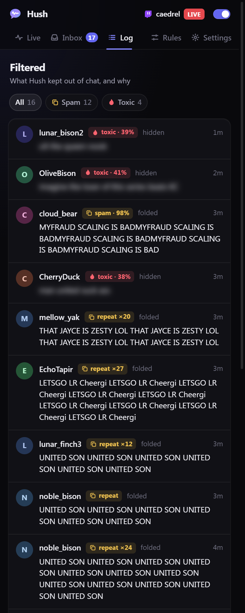<br><sub><b>Log.</b> What was filtered and why. Toxic text stays blurred.</sub></td>
  </tr>
  <tr>
    <td align="center" colspan="2">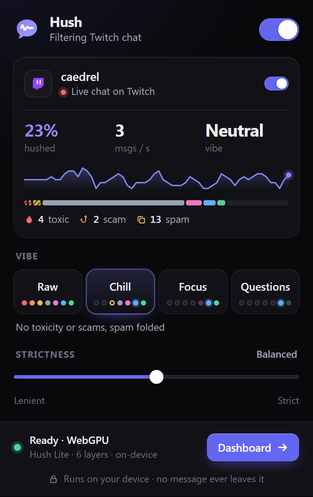<br><sub><b>Popup.</b> Preset, strictness, model status.</sub></td>
    <td align="center" colspan="2">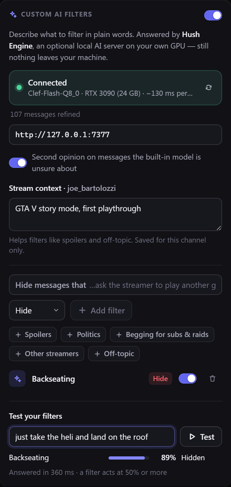<br><sub><b>Custom AI filters.</b> Tiho Engine on an RTX 3090 with a Backseating filter.</sub></td>
  </tr>
</table>

<p align="center"><sub>Captured on live Twitch, Kick and YouTube streams with the bundled model. Chatter names, @mentions and avatars were swapped for made-up handles in the page before each capture (<code>extension/tests/tools/anonymize.js</code>); message text and Tiho's verdicts are untouched.</sub></p>

---

## What it does

- **Hides the ugly.** Insults, harassment, slurs, threats, scam links, bots and "free robux" pitches are hidden. Spam is folded into a thin `2 hidden · show` pill. One click (or Enter on the focused pill) brings any of it back.
- **Folds waves.** When 37 people type `KEKW` within a few seconds, you see one `KEKW ×37` with a live counter. Waves are chat culture, not spam, so they stay, just compact. Copypasta with small edits joins the same wave.
- **Surfaces questions.** Real questions get a soft highlight and collect in an inbox in the side panel, so the one person asking something does not drown in emotes.
- **One choice, or full control.** **Basic** mode (the default) is one choice above chat: Off, Clean or Quiet. No numbers, no categories. **Show hidden** brings back what Tiho took out, faded and labelled in place (`Hidden · spam`), until you press it again. **Advanced** mode is for streamers and mods: four presets (Raw, Clean, Quiet, Questions), what to do with each category, live counts of what is in chat now, rules, custom AI filters, messages per second and the mood of the last 5 minutes. A strictness slider moves every threshold at once. Switching modes never changes what is filtered.
- **Solo: check one category.** In Advanced mode, click a category chip and chat shows only that category, each message tagged with why it is there and what normally happens to it (`spam · 97% · folded`). Click again or press Esc to see everything. Right-click a chip, or use the side panel, to change what happens to that category.
- **Many languages.** The model is [mmBERT](https://huggingface.co/jhu-clsp/mmBERT-small), fine-tuned on real chat from Twitch, YouTube and Kick channels in about 30 stream languages. It is properly checked on English and about a dozen others, the 13 stream languages with at least 40 messages in the test set (see the [model card](docs/MODEL_CARD.md#evaluation)); other languages may work, but are untested. Rules see through leetspeak and lookalike letters (`fr33 r0bux` reads as `free robux`).
- **Your rules first.** Word, regex and user rules (block, allow or highlight) run before the model, in microseconds. "Not spam" in the log adds an allow rule.
- **Never hides by default:** the broadcaster, moderators and VIPs, paid messages (Super Chats, Bits, Kicks), and messages that mention you (on Twitch and YouTube, where Tiho can tell who you are).
- **Private.** Every message is classified on your device, on the GPU through WebGPU or on the CPU through WebAssembly. No account, no analytics, no server. See [PRIVACY.md](PRIVACY.md).

| Preset | Toxic | Scam | Spam | Noise | Negative | Questions | Positive | Other |
|---|---|---|---|---|---|---|---|---|
| **Raw** | show | show | show | show | show | show | show | show |
| **Clean** (default) | hide | hide | fold | show | show | highlight | show | show |
| **Quiet** | hide | hide | hide | hide | dim | highlight | show | show |
| **Questions** | hide | hide | hide | hide | hide | highlight | dim | dim |

"Noise" means one-word reactions with no content (`W`, `L`, `lol`, `first`, `!commands`). Folding waves is a separate switch (on by default), so it works with every preset.

## Where it stands

- **It's early.** We're testing it on real streams right now, and it still makes mistakes: it lets some abuse through and sometimes hides a normal message. Anything Tiho hides is one click away, and "not spam" keeps it from hiding that again.
- **Languages.** Checked properly on English and about a dozen others, so far. The rest is untested.
- **Your computer does the work.** On older computers it can fall behind in very busy chats. Messages the model has not reached in time are shown with the rules' verdict only.
- **Free, no account.** There is no Tiho server, so there is nothing to sign up for and nothing to collect.

## Install

Tiho needs **Chrome or Edge 124 or newer**, on desktop. It is built and tested on Chrome and has been tried on Edge; other Chromium browsers may work but are not tested. It is not in the Chrome Web Store yet, so you load it as an unpacked extension.

### From a release

1. Download the latest `tiho-*-chrome.zip` from [Releases](https://github.com/daradudai/tiho/releases) and unzip it.
2. Open `chrome://extensions`, turn on **Developer mode** (top right), click **Load unpacked** and pick the unzipped folder (the one with `manifest.json`).
3. A welcome tab opens. Pick how much Tiho should hide (Clean or Quiet), then open any live stream. Chats that were already open start filtering too, without a reload.

Release builds include the model, so nothing is downloaded and Tiho works offline from the first message.

### From source

You need Node.js 22 and the model. **The model is not in git** (105 to 113 MB per file), so download a release zip as above and unzip it first: the build bundles whatever is in `extension/public/models/tiho-lite/`.

```sh
git clone https://github.com/daradudai/tiho.git
cd tiho/extension
npm ci
cp -r path/to/unzipped-release/models public/   # PowerShell: Copy-Item -Recurse path\to\unzipped-release\models public\
npm run build                                   # output: extension/.output/chrome-mv3
```

Check that `extension/public/models/tiho-lite/config.json` exists before you build, then load `extension/.output/chrome-mv3` as above.

Instead of a release, you can export your own students and combine them as described in [ml/README.md](ml/README.md#9-export). By default only the two files the extension uses are bundled, the 6-layer `onnx/model_quantized.onnx` for WebGPU and the 3-layer `onnx/model_uint8_3L.onnx` for WASM, plus the tokenizer and config.

Without the folder the build has no model. Tiho still runs, but only the Tier-0 rules filter, and the model status says "Model not included in this build". There is no default download location.

To keep the model out of the zip, you can host the model folder yourself: build with `WXT_TIHO_MODEL_URL` set to its base URL and `TIHO_BUNDLE_MODEL=0`. The build still needs the model folder, because it pins the SHA-256 and size of every file, and the extension uses a downloaded file only if it matches. Each browser then downloads only the file for its backend (112.5 MB on WebGPU, 105.3 MB on the CPU) plus the tokenizer (13.7 MB), once, and keeps them in Cache Storage. Until the model is ready, the rules filter on their own.

Build switches and dev workflow: [extension/README.md](extension/README.md).

## Tiho Engine (optional, local GPU)

The in-browser model knows seven fixed categories. **Tiho Engine** adds filters you write in plain words: *"hide messages that are backseating the streamer"*, *"hide spoilers for Elden Ring"*. It is a small local server (`engine/`, FastAPI on `127.0.0.1:7377`) in front of llama.cpp running [Cloudflare Clef-Flash](https://huggingface.co/Cloudflare/clef-flash), a 9B decision model. A decision model returns a probability for each answer in one forward pass and never generates text, so it is fast and its output never needs parsing. It can also give a second opinion on messages the in-browser model is unsure about.

- Best on an NVIDIA GPU: 7.5 GB of VRAM runs the 6 GiB `Q4_K_M` model, 14 GB or more the 9 GiB `Q8_0`. Without NVIDIA it uses llama.cpp's Vulkan build (Windows, Linux) or the regular build (macOS); with too little VRAM, llama.cpp offloads to the CPU and it gets slow.
- Windows: `cd engine` then `.\start.ps1`. Linux, macOS or Git Bash: `./start.sh`. The first run creates a Python virtual environment (needs Python 3.10+), downloads llama.cpp and the model (resumable, SHA-256 verified) and starts both.
- Binds to `127.0.0.1` only and accepts requests only from extension and localhost origins. The llama.cpp server it starts gets a new random API key on every run, so no web page can use it either.
- Turn it on in **Side panel → Rules → Custom AI filters**. There you can also test a filter on a sample message and give each channel a short stream context ("Elden Ring, first playthrough") that the engine sees with every question.
- The extension's background worker sends the engine each text right after the in-browser model has scored it, so only messages that reached the model (not those decided by rules or answered from the tab's own cache), and none from chats in background tabs. Every custom filter is asked about every such text. The second opinion is asked only where the in-browser model was close to a threshold that would dim, fold or hide something. Its scores are then averaged with the local ones, each against thresholds calibrated for its own model, so it settles close calls instead of overruling the in-browser model. On the gold set's close calls, measured with the first (v2) students, next to the 6-layer model this hid fewer clean messages and caught more bad ones than the model alone; next to the 3-layer model the two came out about even. It has not been measured again with v3.
- Answers stream back one by one, a moment after the local verdict, and update the message where it is, even if it is already on screen. A filter that fires can highlight, dim, fold or hide a message; it never makes a verdict milder. Each text has 2.5 seconds: answers that would come later are dropped, and under load the newest messages are asked first.
- One RTX 3090 answers about 10 messages per second with 3 filters, so in a very busy chat the engine keeps up with only part of it. Each text is asked once: answers are cached in the extension and in the engine, so repeats and waves cost nothing.

Full details (requirements per GPU, API, scheduling, security): [engine/README.md](engine/README.md).

## How it works

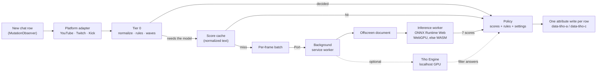

1. **One observer per chat.** A content script watches only the chat list. Each platform adapter turns a DOM row into a plain message: author, roles, text with emotes as their codes, mentions, paid flag. Adapters were checked against the live sites (Twitch also with 7TV, and Kick's virtualized list) and are tested against saved HTML fixtures.
2. **Tier 0, in microseconds.** Text is normalized (Unicode, zero-width and zalgo characters, homoglyphs, leetspeak, repeated characters). Rules decide the obvious cases on their own (your rules, `!commands`, floods, duplicates, emote-only lines, known scam patterns) and add signals for the rest (untrusted links, caps, repeats). A SimHash index finds waves across users in a sliding window.
3. **The model, off the page.** Messages that still need an opinion are batched once per frame and sent to the background service worker, which forwards them to one offscreen document shared by all tabs. Its worker runs **Tiho Lite**, a distilled mmBERT with seven sigmoid outputs (`toxic, spam, scam, noise, question, positive, negative`), in the size that suits the device: 6 layers on the GPU through WebGPU, 3 layers on the CPU through WebAssembly. It batches dynamically, groups texts of similar length, dedups, and caches 20k results. Repeats and waves never reach the model twice. When it falls behind, the newest messages go first, and a message that has waited 2 seconds is dropped and keeps its rules-only verdict.
4. **Policy.** Scores are compared with per-label thresholds calibrated on the gold evaluation set (for each model size separately) and shifted by your strictness setting. The category with the highest priority wins (toxic > scam > spam > noise > question > negative > positive) and maps to your action for it. Privileged authors, paid messages, your own messages and mentions of you are capped at show or highlight.
5. **No flash, no jank.** When a category you hide depends on the model, new rows stay invisible until they have a verdict, for at most 250 ms (configurable). If the model is late, the message shows and is re-checked when its score lands. All writes happen in one pass per animation frame, as attributes only, styled by one injected stylesheet. Tiho never reads layout in the hot path.

More: [docs/architecture.md](docs/architecture.md).

## Performance

The cost on the page was measured on a Ryzen 9 3950X + RTX 3090 under Windows 11 while the machine was busy with model training and labeling, so treat those absolute numbers as pessimistic. The model speed was measured on the same PC with the GPU idle, and on an Apple M4 Mac mini. Full method and raw tables: [content-script stress results](extension/tests/stress/RESULTS.md) and [inference benchmark](extension/tests/bench/RESULTS.md).

**Cost on the page** (mock Twitch / YouTube chat fed with real chat lines, Tiho paused vs. running in alternating windows):

| Chat speed | Script + style + layout Tiho adds per message | All main-thread work Tiho adds per message | Longest single Tiho callback | Page long tasks (paused / running) | Row insert → verdict, p50 / p95 |
|---|---|---|---|---|---|
| 100 msg/s | 0.16 to 0.17 ms | 0.26 ms | 0.4 to 0.8 ms | 0 / 0 | 38 to 39 / 64 to 65 ms |
| 200 msg/s | 0.11 to 0.12 ms | 0.14 to 0.15 ms | 0.8 to 0.9 ms | 0 / 0 | 34 to 35 / 60 to 66 ms |
| 100 msg/s, CPU throttled ×4 | 0.71 ms | 1.2 ms | 2.4 ms | 1 / 0 | 50 / 77 ms |

Ranges cover the Twitch and YouTube skins. "All main-thread work" also counts painting the rows Tiho hides or folds, and is noisier on a shared machine. Under ×4 throttling the one long task came while Tiho was paused.

In a 5-minute soak at 100 msg/s the page heap grew 1.4 MB (6.6 → 8.0 MB; the score cache sits at its 5,000-entry cap from 90 s on) and no frame took over 33 ms. These runs simulate inference latency (25 ms + 0.4 ms per item); with the real extension and the model on WASM, a 50 msg/s smoke test measured p50 10 to 30 ms and p95 about 60 ms from row insert to verdict, with no long tasks.

**Model speed** of the two files the extension uses (inference worker in Playwright's Chromium, score cache off, 4,000 real chat lines). Messages per second at batch 32 / 64; the stream column offers 150 msg/s to WebGPU with the production batching and reports latency p50 / p95:

| Machine | WebGPU, 6 layers `q8`, B32 / B64 | WebGPU stream | CPU (WASM), 3 layers `uint8`, 4 threads, B32 / B64 | CPU, 1 thread, B64 |
|---|---|---|---|---|
| Ryzen 9 3950X + RTX 3090, Windows 11 | 1,731 / 2,932 | 23.5 / 27.5 ms | 492 / 577 | 277 |
| Mac mini, Apple M4, macOS 26.3 | 1,420 / 1,603 | 24.3 / 29.1 ms | 1,027 / 1,146 | 353 |

These runs used the v2 students. The v3 files that ship now have the same architecture, graph and size (only the weights differ), so the same speeds apply. Loading the model from the extension's own files took 0.5 to 1.8 s.

Honest caveats:

- Neither machine is a mid-range or older computer. A typical laptop CPU is roughly 2 to 3 times slower per core than the Ryzen, and integrated GPUs are not measured yet. On older computers Tiho can fall behind in very busy chats.
- Real chats rarely go above 150 msg/s, and many messages never reach the model: Tier-0 rules decide them, or the cache already knows the text (about 35% of messages in the stress runs at 200 msg/s).
- The 22-layer model could not reach the 300 msg/s goal on a 4-thread CPU (132 msg/s at batch 64, in the benchmark's history section). That is why the model is adaptive: the 3-layer student does 577 msg/s on the same CPU and stays within 0.007 macro AP of the 6-layer one on the gold set (see below).

## The model

**Tiho Lite v3-6L + v3-3L**, an adaptive pair. WebGPU runs the 6-layer student, the CPU (WASM) the 3-layer one. They share one tokenizer, and each browser loads only one of them. [jhu-clsp/mmBERT-small](https://huggingface.co/jhu-clsp/mmBERT-small) (ModernBERT architecture) was fine-tuned as a 22-layer model (v2) and distilled into 6- and 3-layer students. For v3 those students were distilled again from a stronger teacher, the average of v2 and a fine-tuned mmBERT-base (307M parameters, trained on the teacher, silver and active-learning labels), on 1.2 to 1.3 million unique real chat messages. The 6-layer student has 110M parameters and the 3-layer one 104M, but 98M of either is the 256k-token embedding table: what shrinks is the compute per message, with 6 or 3 encoder layers instead of 22. Seven independent sigmoid outputs, max 64 tokens. MIT license.

Gold set: 2,000 real chat messages from all three platforms, kept out of training by exact text match (v2 still saw 10 very short ones, such as `boo` and `KEKW KEKW KEKW`, in public and synthetic data, and v3 builds on v2), labeled by two independent Claude annotators that could not see each other's labels, plus a third that settled disagreements (the two agreed on all seven labels for 92% of messages). Scores are average precision (AP) per label, macro-averaged:

| Model | Macro AP |
|---|---|
| Teacher: Clef-Flash 9B (zero-shot decision model) | 0.721 |
| Student v0 (teacher labels + public data) | 0.627 |
| v1 (+ 12k silver labels) | 0.778 |
| v2 (+ 5.8k active-learning labels), 22 layers | 0.816 |
| v2-9L (9 layers, distilled) | 0.822 |
| v2-6L (6 layers, distilled), shipped for WebGPU in the first builds | 0.822 |
| v2-3L (3 layers, distilled), shipped for the CPU in the first builds | 0.815 |
| v3-base (mmBERT-base, 307M parameters), teacher only | 0.821 |
| **v3-6L** (v2-6L distilled again from v3-base + v2), **shipped for WebGPU** | **0.846** |
| **v3-3L** (v2-3L, same recipe), **shipped for the CPU** | **0.839** |

Per label, on the text exactly as the extension feeds it to the model:

| | toxic | spam | scam | noise | question | positive | negative |
|---|---|---|---|---|---|---|---|
| v3-6L AP | 0.680 | 0.908 | 0.912 | 0.933 | 0.956 | 0.809 | 0.727 |
| v3-3L AP | 0.657 | 0.907 | 0.904 | 0.929 | 0.954 | 0.807 | 0.714 |
| v2-6L AP (first builds) | 0.623 | 0.910 | 0.894 | 0.931 | 0.940 | 0.782 | 0.674 |
| v2-3L AP (first builds) | 0.618 | 0.902 | 0.882 | 0.930 | 0.935 | 0.771 | 0.663 |

The best epoch of each run was also picked on the gold set, so these AP numbers are slightly optimistic. Each student has its own thresholds, fit on the gold set. To score them on messages they were not fit on, the set is split five ways and each fifth is scored with thresholds fit on the other four (cross-validation). Measured that way, the 6-layer student reaches macro F1 0.763 and the 3-layer one 0.754 (v2: 0.734 and 0.748). For the 6-layer student that means scam precision 0.95, spam precision 0.86, question F1 0.91 and **toxic precision 0.73 at recall 0.52**. The 3-layer student has its own trade-off: toxic precision 0.69 at recall 0.47, spam precision 0.88, scam precision 0.98. Thresholds for the harmful labels favor precision, because hiding a good message is worse than missing a bad one. In plain words: the model catches scams and spam well, and lets about half of the toxic messages in the test set through at the default strictness. In live chat it likely misses more: most toxic test messages were picked because the teacher model had already flagged them. Weighted back to how the test set was sampled, toxic recall is about 0.45 (GPU) and 0.41 (CPU), a rough estimate that rests on only 12 randomly sampled toxic messages. Move the slider toward Strict if you want more caught.

| File | Model | Size | Used for |
|---|---|---|---|
| `onnx/model_quantized.onnx` (q8) | 6 layers | 112.5 MB | WebGPU (default) |
| `onnx/model_uint8_3L.onnx` (uint8) | 3 layers | 105.3 MB | WASM / CPU (default) |
| `onnx/model_q4f16.onnx` (q4f16) | 6 layers | 61.9 MB | optional, WebGPU only; smallest, but 0.75% of decisions differ from fp32 |
| `tokenizer.json` | | 13.7 MB | both |

Each browser loads one model file and the tokenizer: 126 MB on WebGPU, 119 MB on the CPU.

Data, training, evaluation, limitations and biases: **[MODEL_CARD](docs/MODEL_CARD.md)**. Pipeline and scripts: [ml/README.md](ml/README.md).

## Privacy

- Chat text is classified inside your browser. Tiho has no server, no account, no analytics and no telemetry.
- Tiho makes two kinds of network requests, no more: the one-time model download, only in a build made to download it (release zips include the model, so they never download it), and, if you turn it on, requests to Tiho Engine at the address in your settings, by default `http://127.0.0.1:7377` on your own computer. While the engine is off, nothing is sent to it.
- Settings and your "not spam" feedback stay in your browser's extension storage. The filtered log and the questions inbox live in memory and disappear when you close the tab.

Details: [PRIVACY.md](PRIVACY.md).

## Repository

```
extension/   Chrome MV3 extension (WXT, TypeScript, Preact)
  src/core/        types, normalize, rules, waves, policy, settings
  src/platforms/   YouTube, Twitch, Kick DOM adapters
  src/runtime/     content-script engine (observer, frame loop, classifier client)
  src/inference/   offscreen host + worker: ONNX Runtime Web, batching, cache
  src/engine-client/  background client for Tiho Engine: routing, batching, deadlines
  src/ui/          in-chat bar, decorations, popup, side panel, onboarding
  tests/           vitest unit tests, fixtures, stress and inference benchmarks
engine/      Tiho Engine: local FastAPI server in front of llama.cpp + Clef-Flash
ml/          data collection, labeling, training, distillation, ONNX export
docs/        architecture, model card, live test report, screenshots
SPEC.md      the design contract between the parts
```

## Contributing

Bug reports, wrong verdicts, new platform quirks and translations of hard cases are all welcome. Start with [CONTRIBUTING.md](CONTRIBUTING.md). Each part has its own guide: [extension](extension/README.md), [engine](engine/README.md), [ml](ml/README.md).

## Acknowledgements

Tiho stands on a lot of open work:

- [mmBERT](https://huggingface.co/jhu-clsp/mmBERT-small) by the Johns Hopkins University CLSP team (MIT), the base of the in-browser model, and [ModernBERT](https://huggingface.co/answerdotai/ModernBERT-base), its architecture.
- [Clef-Flash](https://huggingface.co/Cloudflare/clef-flash) by Cloudflare (Apache-2.0), the teacher for training labels and the model behind Tiho Engine.
- [llama.cpp](https://github.com/ggml-org/llama.cpp) (MIT), which serves Clef-Flash.
- [ONNX Runtime Web](https://github.com/microsoft/onnxruntime) (MIT) for WebGPU and WASM inference, and [Transformers.js](https://github.com/huggingface/transformers.js) (Apache-2.0) for the tokenizer.
- [WXT](https://wxt.dev) (MIT), [Preact](https://preactjs.com) and [@preact/signals](https://github.com/preactjs/signals) (MIT), [FastAPI](https://fastapi.tiangolo.com) (MIT).
- Public datasets used for training, all with permissive licenses:
  [google/civil_comments](https://huggingface.co/datasets/google/civil_comments) (CC0),
  [FredZhang7/toxi-text-3M](https://huggingface.co/datasets/FredZhang7/toxi-text-3M) (Apache-2.0),
  [thehamkercat/telegram-spam-ham](https://huggingface.co/datasets/thehamkercat/telegram-spam-ham) (WTFPL),
  [wangyuancheng/discord-phishing-scam](https://huggingface.co/datasets/wangyuancheng/discord-phishing-scam) (MIT),
  [FredZhang7/all-scam-spam](https://huggingface.co/datasets/FredZhang7/all-scam-spam) (Apache-2.0),
  [clapAI/MultiLingualSentiment](https://huggingface.co/datasets/clapAI/MultiLingualSentiment) (Apache-2.0),
  and the [YouTube Spam Collection](https://doi.org/10.24432/C58885) by T. C. Alberto and J. V. Lochter, UCI Machine Learning Repository (CC BY 4.0).

## License

[MIT](LICENSE) for the code and the Tiho Lite model weights. The extension bundles ONNX Runtime Web, Transformers.js, Preact and mmBERT's tokenizer under their own licenses (MIT and Apache-2.0); see [THIRD_PARTY_NOTICES.md](THIRD_PARTY_NOTICES.md), which every build carries next to `LICENSE`. Clef-Flash and llama.cpp are downloaded by Tiho Engine from their own sources under their own licenses (Apache-2.0 and MIT); they are not part of this repository.
