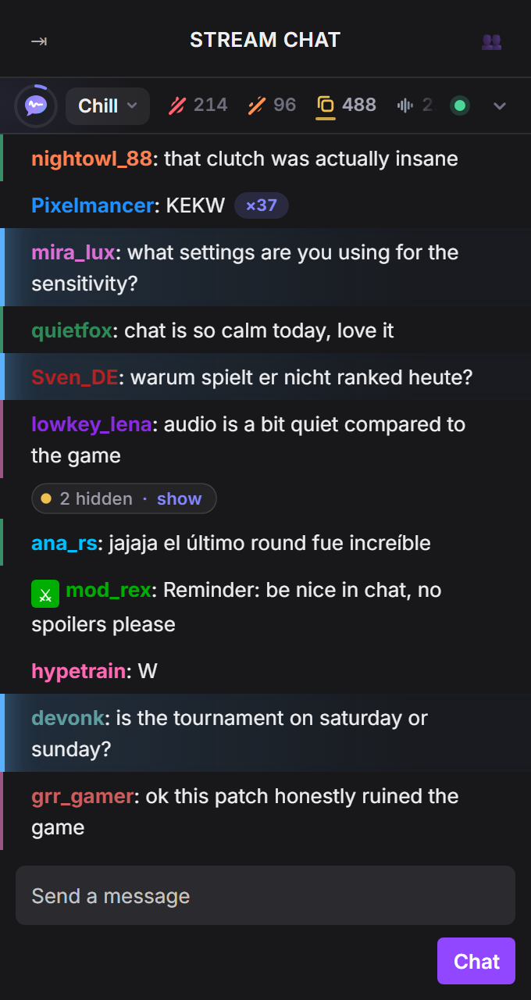
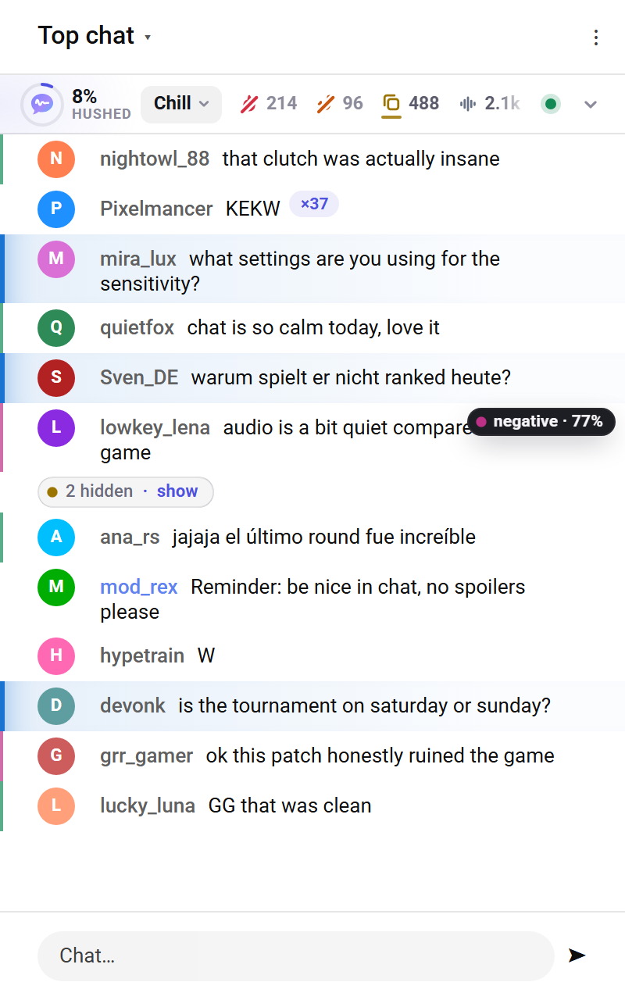
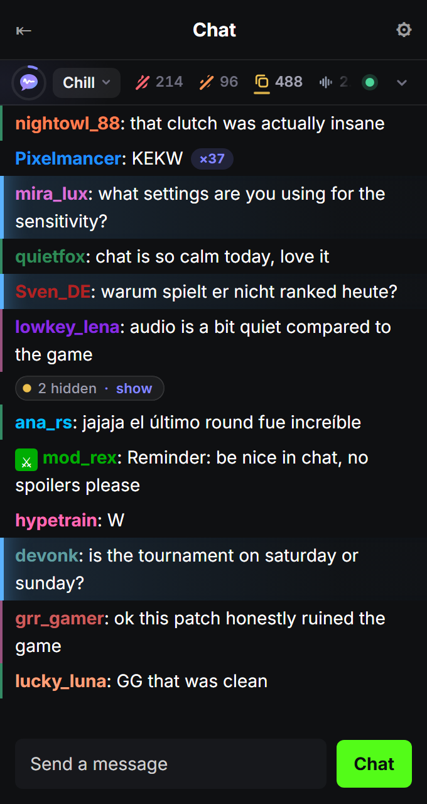
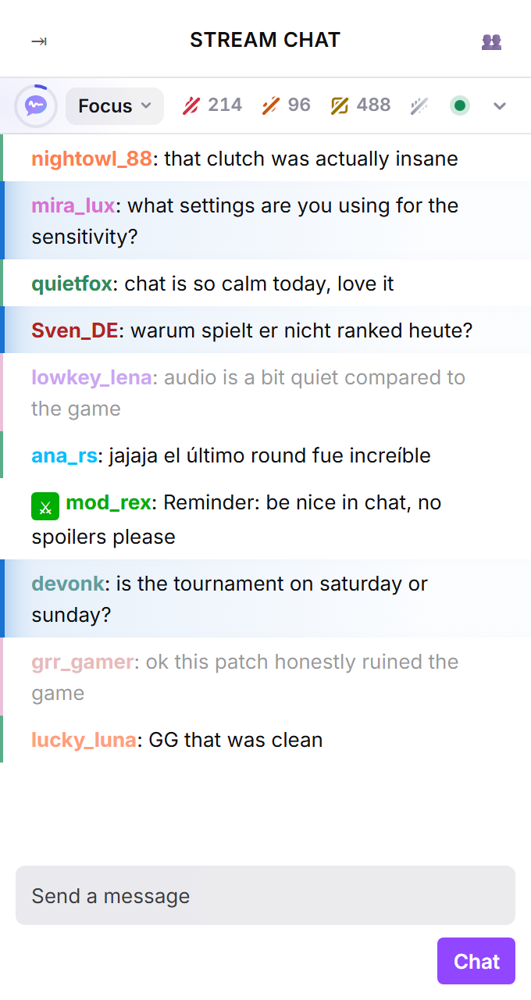
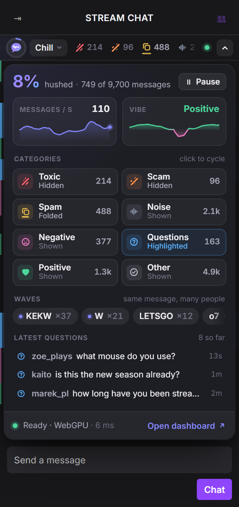
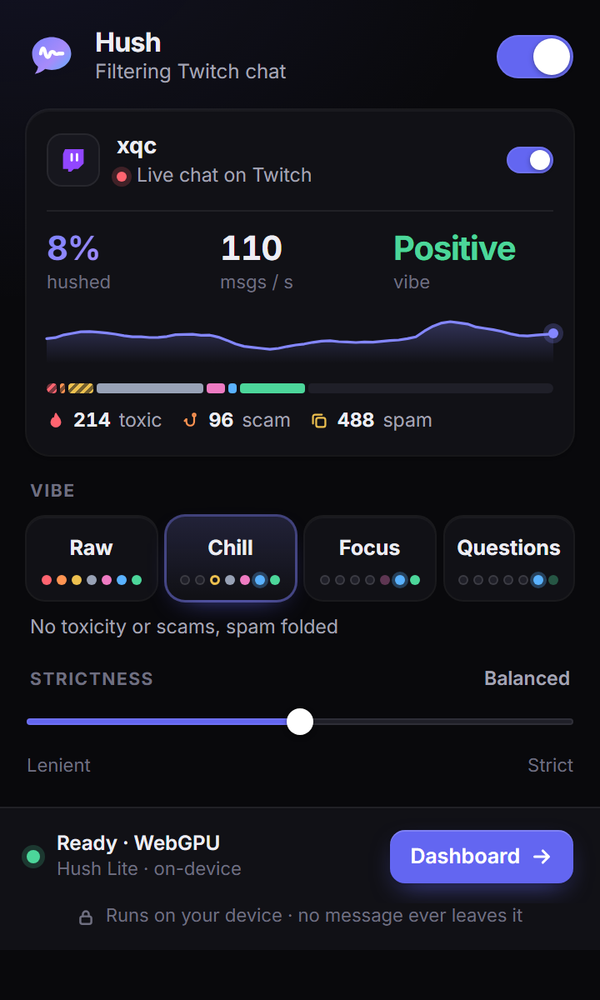
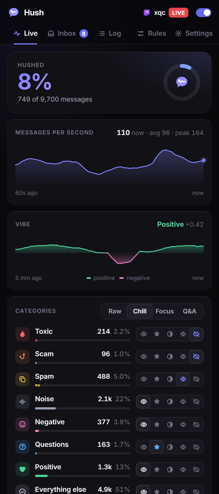
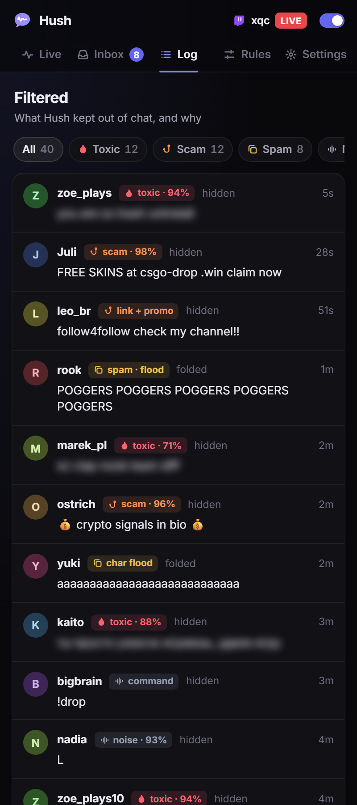
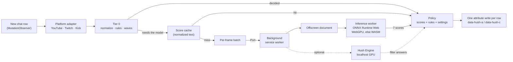

<p align="center">
  
</p>

<h1 align="center">Hush</h1>

<p align="center">
  <b>An ad-blocker for live chat.</b><br>
  A small AI model in your browser hides toxicity, scams and spam on YouTube, Twitch and Kick, in any language.<br>
  Nothing leaves your machine.
</p>

<p align="center">
  <a href="https://github.com/daradudai/hush/actions/workflows/ci.yml"></a>
  <a href="LICENSE"></a>
  
  
</p>

<!-- docs/img/*.png are copies of extension/tests/ui/screenshots/ (node tests/ui/shoot.mjs):
     twitch-chill = chat-twitch-dark, youtube-reason = chat-youtube-light-hover, kick-chill = chat-kick-dark,
     twitch-focus = chat-twitch-light-focus, twitch-dashboard = chat-twitch-dark-open, popup = popup-dark,
     sidepanel-live = sidepanel-live-dark, sidepanel-log = sidepanel-log-dark -->
<table>
  <tr>
    <td align="center" width="25%"><br><sub><b>Twitch, Chill preset.</b> Toxic and scam hidden, spam folded, "KEKW ×37" wave, questions lit up.</sub></td>
    <td align="center" width="25%"><br><sub><b>YouTube.</b> Hover a message to see why it was tagged.</sub></td>
    <td align="center" width="25%"><br><sub><b>Kick.</b> Same bar, native look on each site.</sub></td>
    <td align="center" width="25%"><br><sub><b>Focus preset.</b> One-word noise gone, complaints dimmed.</sub></td>
  </tr>
  <tr>
    <td align="center"><br><sub><b>Bar, expanded.</b> Rate, vibe, categories, waves, latest questions.</sub></td>
    <td align="center"><br><sub><b>Popup.</b> Preset, strictness, model status.</sub></td>
    <td align="center"><br><sub><b>Side panel.</b> Live stats and per-category control.</sub></td>
    <td align="center"><br><sub><b>Log.</b> What was filtered and why. One click to undo.</sub></td>
  </tr>
</table>

<p align="center"><sub>These are renders of the real UI components on a mock chat (<code>extension/tests/ui/showcase</code>), not captures of live streams. Names and counts are sample data.</sub></p>

---

## What it does

- **Hides the ugly.** Insults, harassment, slurs, threats, scam links, bots and "free robux" pitches are hidden. Spam is folded into a thin `2 hidden · show` pill. One click brings any of it back.
- **Folds waves.** When 37 people type `KEKW` within a few seconds, you see one `KEKW ×37` with a live counter. Waves are chat culture, not spam, so they stay, just compact. Copypasta with small edits joins the same wave.
- **Surfaces questions.** Real questions get a soft highlight and collect in an inbox in the side panel, so the one person asking something does not drown in emotes.
- **Reads the room.** A slim bar above chat shows how much was hushed, messages per second and a **vibe meter** (positive vs. negative over the last few minutes).
- **Four presets, full control.** Raw, Chill, Focus, Questions. Click a category chip to cycle show / dim / fold / hide, or set each category exactly in the side panel. A strictness slider moves every threshold at once.
- **Any language.** The model is [mmBERT](https://huggingface.co/jhu-clsp/mmBERT-small), pre-trained on 1800+ languages, fine-tuned on real chat from Twitch, YouTube and Kick channels in about 30 stream languages. Quality is measured for the ten biggest of them (see the [model card](docs/MODEL_CARD.md#evaluation)). Rules see through leetspeak and lookalike letters (`fr33 r0bux` reads as `free robux`).
- **Your rules first.** Word, regex and user rules (block, allow or highlight) run before the model, in microseconds. "Not spam" in the log adds an allow rule.
- **Never hides by default:** the broadcaster, moderators and VIPs, paid messages (Super Chats, Bits, Kicks), and messages that mention you (on Twitch and YouTube, where Hush can tell who you are).
- **Private.** Every message is classified on your device, on the GPU through WebGPU or on the CPU through WebAssembly. No account, no analytics, no server. See [PRIVACY.md](PRIVACY.md).

| Preset | Toxic | Scam | Spam | Noise | Negative | Questions | Positive | Everything else |
|---|---|---|---|---|---|---|---|---|
| **Raw** | show | show | show | show | show | show | show | show |
| **Chill** (default) | hide | hide | fold | show | show | highlight | show | show |
| **Focus** | hide | hide | hide | hide | dim | highlight | show | show |
| **Questions** | hide | hide | hide | hide | hide | highlight | dim | dim |

"Noise" means one-word reactions with no content (`W`, `L`, `lol`, `first`, `!commands`). Folding waves is a separate switch (on by default), so it works with every preset.

## Install

Hush needs **Chrome 124 or newer**. It is built and tested on Chrome; other Chromium browsers may work but are not tested. It is not in the Chrome Web Store yet, so you load it as an unpacked extension.

### From a release

1. Download the latest `hush-*-chrome.zip` from [Releases](https://github.com/daradudai/hush/releases) and unzip it.
2. Open `chrome://extensions`, turn on **Developer mode** (top right), click **Load unpacked** and pick the unzipped folder (the one with `manifest.json`).
3. A welcome tab opens. Pick a preset, then open any live stream.

Release builds include the model, so nothing is downloaded and Hush works offline from the first message.

### From source

You need Node.js 22.

```sh
git clone https://github.com/daradudai/hush.git
cd hush/extension
npm ci
npm run build          # output: extension/.output/chrome-mv3
```

Then load `extension/.output/chrome-mv3` as above.

**The model is not in git** (it is ~120 MB per file). The build bundles whatever is in `extension/public/models/hush-lite/`:

- **Bundled (recommended).** Put the model folder there before you build. Copy `models/hush-lite/` out of a release zip, or export your own checkpoint with [`ml/export/export_onnx.py`](ml/README.md#9-export). By default only the two files the extension uses are bundled (`onnx/model_quantized.onnx` for WebGPU, `onnx/model_uint8.onnx` for WASM) plus the tokenizer and config.
- **Downloaded.** If the folder is missing, the extension fetches the model on first use from `REMOTE_MODEL_URL` in [`src/inference/config.ts`](extension/src/inference/config.ts) (override at build time with `WXT_HUSH_MODEL_URL`). It downloads one model file (about 120 MB) plus the tokenizer (13.7 MB) and keeps them in the browser's Cache Storage. Until the model is ready, the Tier-0 rules filter on their own.

<!-- TODO(lead): the default REMOTE_MODEL_URL (huggingface.co/hush-chat/hush-lite) is not published yet. Remove this comment and the sentence below once it is. -->
> [!NOTE]
> The default download location (`huggingface.co/hush-chat/hush-lite`) is not published yet. For now, bundle the model or point `WXT_HUSH_MODEL_URL` at your own copy.

Build switches and dev workflow: [extension/README.md](extension/README.md).

## Hush Engine (optional, local GPU)

The in-browser model knows seven fixed categories. **Hush Engine** adds filters you write in plain words: *"hide messages that are backseating the streamer"*, *"hide spoilers for Elden Ring"*. It is a small local server (`engine/`, FastAPI on `127.0.0.1:7377`) in front of llama.cpp running [Cloudflare Clef-Flash](https://huggingface.co/Cloudflare/clef-flash), a 9B decision model. A decision model returns a probability for each answer in one forward pass and never generates text, so it is fast and its output never needs parsing. It can also give a second opinion on messages the in-browser model is unsure about.

- Best on an NVIDIA GPU: 7.5 GB of VRAM runs the 6 GiB `Q4_K_M` model, 14 GB or more the 9 GiB `Q8_0`. Without NVIDIA it uses llama.cpp's Vulkan build (Windows, Linux) or the regular build (macOS); with too little VRAM, llama.cpp offloads to the CPU and it gets slow.
- Windows: `cd engine` then `.\start.ps1`. Linux, macOS or Git Bash: `./start.sh`. The first run creates a Python virtual environment (needs Python 3.10+), downloads llama.cpp and the model (resumable, SHA-256 verified) and starts both.
- Binds to `127.0.0.1` only and accepts requests only from extension and localhost origins.
- Turn it on in **Side panel → Rules → Custom AI filters**. The extension's background worker sends the engine the messages that reached the in-browser model: your custom filters are asked about each of them, the second opinion only where the in-browser model was unsure. Answers arrive a moment after the local verdict and update it; answers that come too late for a live chat are dropped.
- One RTX 3090 answers about 10 messages per second with 3 filters, so in a very busy chat the engine keeps up with only part of it. Repeats and waves are cached.

<!-- TODO(lead): the extension side of this (src/engine-client, background routing) was in progress when this was written. Check the bullet above against what shipped; if routing did not land, replace it with a note that the extension only shows engine status and stores filters for now. -->

Full details (requirements per GPU, API, scheduling, security): [engine/README.md](engine/README.md).

## How it works



1. **One observer per chat.** A content script watches only the chat list. Each platform adapter turns a DOM row into a plain message: author, roles, text with emotes as their codes, mentions, paid flag. Adapters were checked against the live sites (Twitch also with 7TV, and Kick's virtualized list) and are tested against saved HTML fixtures.
2. **Tier 0, in microseconds.** Text is normalized (Unicode, zero-width and zalgo characters, homoglyphs, leetspeak, repeated characters). Rules decide the obvious cases on their own (your rules, `!commands`, floods, duplicates, emote-only lines, known scam patterns) and add signals for the rest (untrusted links, caps, repeats). A SimHash index finds waves across users in a sliding window.
3. **The model, off the page.** Messages that still need an opinion are batched once per frame and sent to the background service worker, which forwards them to one offscreen document shared by all tabs. Its worker runs **Hush Lite**, a 9-layer distilled mmBERT with seven sigmoid outputs: `toxic, spam, scam, noise, question, positive, negative`. It batches dynamically, groups texts of similar length, dedups, and caches 20k results. Repeats and waves never reach the model twice.
4. **Policy.** Scores are compared with per-label thresholds calibrated on the gold evaluation set and shifted by your strictness setting. The category with the highest priority wins (toxic > scam > spam > noise > question > negative > positive) and maps to your action for it. Privileged authors, paid messages and mentions of you are capped at show or highlight.
5. **No flash, no jank.** When a category you hide depends on the model, new rows stay invisible until they have a verdict, for at most 250 ms (configurable). If the model is late, the message shows and is re-checked when its score lands. All writes happen in one pass per animation frame, as attributes only, styled by one injected stylesheet. Hush never reads layout in the hot path.

More: [docs/architecture.md](docs/architecture.md).

## Performance

Measured on a Ryzen 9 3950X + RTX 3090 under Windows 11. The machine was busy with model training and labeling at the same time, so treat absolute numbers as pessimistic. Full method and raw tables: [content-script stress results](extension/tests/stress/RESULTS.md) and [inference benchmark](extension/tests/bench/RESULTS.md).

**Cost on the page** (mock Twitch / YouTube chat fed with real chat lines, Hush paused vs. running in alternating windows):

| Chat speed | Script + style + layout Hush adds per message | Longest single Hush callback | Page long tasks (paused / running) | Row insert → verdict, p50 / p95 |
|---|---|---|---|---|
| 100 msg/s | 0.21 to 0.26 ms | 1.2 ms | 0 / 0 | 35 to 38 / 61 to 64 ms |
| 200 msg/s | 0.15 to 0.20 ms | 1.4 ms | 0 / 0 | 35 to 36 / 60 to 62 ms |
| 100 msg/s, CPU throttled ×4 | 0.88 ms | 4.3 ms | 1 / 2 | 46 / 83 ms |

Ranges cover the Twitch and YouTube skins. Under ×4 throttling the mock page had long tasks with Hush paused too; Hush's longest callback there was 4.3 ms.

In a 5-minute soak at 100 msg/s the page heap grew 1.4 MB (6.6 → 8.0 MB; the score cache sits at its 5,000-entry cap from 90 s on) and no frame took over 33 ms. These runs simulate inference latency (25 ms + 0.4 ms per item); with the real extension and the model on WASM, a 50 msg/s smoke test measured p50 10 to 30 ms and p95 about 60 ms from row insert to verdict, with no long tasks.

**Model speed** (worker only, no cache, 4,000 real chat lines). Measured with the earlier 22-layer v2 model; the shipped 9-layer model does about 40% of the compute per token and has not been benchmarked yet.

| Backend | File | Batch 1 | Batch 32 | Simulated stream |
|---|---|---|---|---|
| WebGPU | `q8` | 46 msg/s, p50 21.5 ms | 564 msg/s, p50 58.5 ms | 150 msg/s offered → 142 handled, p95 53 ms |
| WASM, 4 threads | `uint8` | 70 msg/s, p50 12.7 ms | 115 msg/s | 60 msg/s offered → 56 handled, p95 136 ms |

Honest caveats:

- The GPU was 95 to 100% busy with other work during the WebGPU runs, so those numbers mostly measure waiting for the GPU. They need an idle-GPU re-run before anyone quotes them.
- On the CPU path the 22-layer model could not reach the 300 msg/s goal. That is why the shipped model is a 9-layer distillation with the same quality on the gold set (see below).
- In real chats a large share of messages never reaches the model: Tier-0 rules decide them, or the cache already knows the text. In the stress runs at 200 msg/s, about 35% of messages were decided by rules or cache.

## The model

**Hush Lite v2-9L**: [jhu-clsp/mmBERT-small](https://huggingface.co/jhu-clsp/mmBERT-small) (ModernBERT architecture), cut to 9 of 22 layers and distilled. 116M parameters, 98M of them in the 256k-token embedding table. Seven independent sigmoid outputs, max 64 tokens. MIT license.

Gold set: 2,000 real chat messages from all three platforms, never used for training, labeled by two independent Claude annotators that could not see each other's labels, plus a third that settled disagreements (the two agreed on all seven labels for 92% of messages). Scores are average precision (AP) per label, macro-averaged:

| Model | Macro AP |
|---|---|
| Teacher: Clef-Flash 9B (zero-shot decision model) | 0.721 |
| Student v0 (teacher labels + public data) | 0.627 |
| v1 (+ 12k silver labels) | 0.778 |
| v2 (+ 5.8k active-learning labels), 22 layers | 0.816 |
| **v2-9L** (9 layers, distilled on 551k unlabeled real messages), **shipped** | **0.822** |
| v2-6L (6 layers) | TODO(lead) |

| | toxic | spam | scam | noise | question | positive | negative |
|---|---|---|---|---|---|---|---|
| v2-9L AP | 0.632 | 0.910 | 0.883 | 0.933 | 0.938 | 0.778 | 0.680 |

The best epoch of each run was also picked on the gold set, so these AP numbers are slightly optimistic. At the shipped thresholds (calibrated on one half of the gold set, scored on the other): macro F1 0.74, scam precision 0.88, spam precision 0.94, question F1 0.91, **toxic precision 0.61 at recall 0.44**. Thresholds for the harmful labels favor precision, because hiding a good message is worse than missing a bad one. In plain words: the model catches scams and spam well, and lets more than half of the toxic messages in the test set through at the default strictness. Move the slider toward Strict if you want more caught.

| File | Size | Used for |
|---|---|---|
| `onnx/model_quantized.onnx` (q8) | 119 MB | WebGPU (default) |
| `onnx/model_uint8.onnx` (uint8) | 117 MB | WASM / CPU (default) |
| `onnx/model_q4f16.onnx` (q4f16) | 65 MB | optional, WebGPU only; smallest, but 0.7% of decisions differ from fp32 |
| `tokenizer.json` | 13.7 MB | both |

Data, training, evaluation, limitations and biases: **[MODEL_CARD](docs/MODEL_CARD.md)**. Pipeline and scripts: [ml/README.md](ml/README.md).

## Privacy

- Chat text is classified inside your browser. Hush has no server, no account, no analytics and no telemetry.
- Hush makes two kinds of network requests, no more: the one-time model download (only when the model is not bundled) and, if you turn it on, requests to Hush Engine at `http://127.0.0.1:7377` on your own computer.
- Settings and your "not spam" feedback stay in your browser's extension storage. The filtered log and the questions inbox live in memory and disappear when you close the tab.

Details: [PRIVACY.md](PRIVACY.md).

## Repository

```
extension/   Chrome MV3 extension (WXT, TypeScript, Preact)
  src/core/        types, normalize, rules, waves, policy, settings
  src/platforms/   YouTube, Twitch, Kick DOM adapters
  src/runtime/     content-script engine (observer, frame loop, classifier client)
  src/inference/   offscreen host + worker: ONNX Runtime Web, batching, cache
  src/ui/          in-chat bar, decorations, popup, side panel, onboarding
  tests/           vitest unit tests, fixtures, stress and inference benchmarks
engine/      Hush Engine: local FastAPI server in front of llama.cpp + Clef-Flash
ml/          data collection, labeling, training, distillation, ONNX export
docs/        architecture, model card, screenshots
SPEC.md      the design contract between the parts
```

## Contributing

Bug reports, wrong verdicts, new platform quirks and translations of hard cases are all welcome. Start with [CONTRIBUTING.md](CONTRIBUTING.md). Each part has its own guide: [extension](extension/README.md), [engine](engine/README.md), [ml](ml/README.md).

## Acknowledgements

Hush stands on a lot of open work:

- [mmBERT](https://huggingface.co/jhu-clsp/mmBERT-small) by the Johns Hopkins University CLSP team (MIT), the base of the in-browser model, and [ModernBERT](https://huggingface.co/answerdotai/ModernBERT-base), its architecture.
- [Clef-Flash](https://huggingface.co/Cloudflare/clef-flash) by Cloudflare (Apache-2.0), the teacher for training labels and the model behind Hush Engine.
- [llama.cpp](https://github.com/ggml-org/llama.cpp) (MIT), which serves Clef-Flash.
- [ONNX Runtime Web](https://github.com/microsoft/onnxruntime) (MIT) for WebGPU and WASM inference, and [Transformers.js](https://github.com/huggingface/transformers.js) (Apache-2.0) for the tokenizer.
- [WXT](https://wxt.dev) (MIT), [Preact](https://preactjs.com) and [@preact/signals](https://github.com/preactjs/signals) (MIT), [FastAPI](https://fastapi.tiangolo.com) (MIT).
- Public datasets used for training, all with permissive licenses:
  [google/civil_comments](https://huggingface.co/datasets/google/civil_comments) (CC0),
  [FredZhang7/toxi-text-3M](https://huggingface.co/datasets/FredZhang7/toxi-text-3M) (Apache-2.0),
  [thehamkercat/telegram-spam-ham](https://huggingface.co/datasets/thehamkercat/telegram-spam-ham) (WTFPL),
  [wangyuancheng/discord-phishing-scam](https://huggingface.co/datasets/wangyuancheng/discord-phishing-scam) (MIT),
  [FredZhang7/all-scam-spam](https://huggingface.co/datasets/FredZhang7/all-scam-spam) (Apache-2.0),
  [clapAI/MultiLingualSentiment](https://huggingface.co/datasets/clapAI/MultiLingualSentiment) (Apache-2.0),
  and the [YouTube Spam Collection](https://archive.ics.uci.edu/dataset/380/youtube+spam+collection) by Alberto, Lochter and Almeida, UCI Machine Learning Repository (CC BY 4.0).

## License

[MIT](LICENSE) for the code and the Hush Lite model weights. Clef-Flash and llama.cpp are downloaded by Hush Engine from their own sources under their own licenses (Apache-2.0 and MIT); they are not part of this repository.
