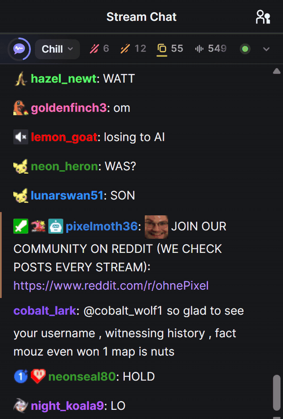

<p align="center">
  
</p>

<h1 align="center">Tiho</h1>

<p align="center">
  <b>Live chat without the junk.</b><br>
  A free browser extension that hides spam, scam links and abuse in YouTube, Twitch and Kick chat.<br>
  A small AI model runs on your own computer. The chat never leaves it.<br>
  <sub>Early version · testing now · <a href="https://tiho.chat">tiho.chat</a></sub>
</p>

<p align="center">
  <a href="https://github.com/daradudai/tiho/actions/workflows/ci.yml"></a>
  <a href="LICENSE"></a>
  
  
</p>

<p align="center">
  
  <br><sub>Tiho on a live Twitch chat (<a href="docs/img/tiho-demo.mp4">MP4</a>). Chatter names are swapped for made-up ones.</sub>
</p>

## What it does

- **Hides the junk.** Insults, harassment, scam links and bots disappear. Spam folds into a small `2 hidden · show` line.
- **Folds waves.** When 37 people post `KEKW` at once, you see it once: `KEKW ×37`.
- **Highlights questions**, so the one person asking something doesn't drown in emotes.
- **Simple by default.** Pick **Off, Clean or Quiet** above the chat. **Show hidden** brings back everything it took out.
- **Advanced mode** for streamers and mods: what happens to each kind of message, your own rules, one-click **Solo** to see a single category, live counts, a log of what was hidden.
- **Leaves alone** the streamer, mods, VIPs, paid messages, and messages that mention you.
- **Private.** Everything runs in your browser, on the GPU (WebGPU) or the CPU. No account, no server, no analytics.

## Where it stands

It's early and it still makes mistakes: some abuse gets through, and now and then a normal message is hidden (one click brings it back). It's checked properly on English and about a dozen other languages; others may work but aren't tested. On older computers it can fall behind in very busy chats.

## Install

Needs **Chrome or Edge 124+** on desktop. (Chrome Web Store listing: coming soon.)

### The easy way: ask your coding agent

If you use Claude Code, Codex, Cursor or a similar agent, paste this:

> Install the Tiho browser extension for me. Download the latest `tiho-*-chrome.zip` from https://github.com/daradudai/tiho/releases, unzip it into a folder I can keep, then tell me exactly how to load that folder in Chrome or Edge (`chrome://extensions` or `edge://extensions` → Developer mode → Load unpacked).

The last click (Load unpacked) is yours: browsers don't let programs install extensions on their own.

### By hand

1. Download the latest `tiho-*-chrome.zip` from [Releases](https://github.com/daradudai/tiho/releases) and unzip it.
2. Open `chrome://extensions` (or `edge://extensions`), turn on **Developer mode**, click **Load unpacked** and pick the unzipped folder (the one with `manifest.json`).
3. Open any live stream on YouTube, Twitch or Kick. The bar appears above the chat.

The release zip already contains the AI model (about 200 MB), so it works offline from the first message.

### From source

You need Node.js 22. The model isn't in git, so take it from a release zip:

```sh
git clone https://github.com/daradudai/tiho.git
cd tiho/extension
npm ci
cp -r path/to/unzipped-release/models public/   # PowerShell: Copy-Item -Recurse path\to\unzipped-release\models public\
npm run build                                   # then load extension/.output/chrome-mv3
```

Without the model the extension still runs, but only its simple rules filter. More build options: [extension/README.md](extension/README.md).

## Optional: Tiho Engine

For people with a strong graphics card: a small local server that runs a larger AI model ([Cloudflare Clef-Flash](https://huggingface.co/Cloudflare/clef-flash), 9B) and lets you write filters in plain words, like *"hide backseating"* or *"hide Elden Ring spoilers"*. It runs only on your computer and is off until you turn it on.

```sh
cd engine
./start.sh        # Windows: .\start.ps1
```

Then turn it on in **Side panel → Rules → Custom AI filters**. Details and GPU requirements: [engine/README.md](engine/README.md).

## How it works

A content script watches only the chat list. Fast rules handle the obvious cases (your rules, floods, repeats, waves) in microseconds. The rest goes in small batches to one shared AI model in the background: **Tiho Lite**, a multilingual [mmBERT](https://huggingface.co/jhu-clsp/mmBERT-small) model distilled down to 6 layers for the GPU and 3 for the CPU. Each message gets seven scores (toxic, spam, scam, noise, question, positive, negative), and your settings decide what to show, fold or hide.

How the model was made: we collected about a million real chat messages from Twitch, Kick and YouTube, labeled them with a large teacher model and with AI annotators, and distilled the result into a model small enough to run in a browser. On our 2,000-message test set it beats the 9B teacher it learned from (macro AP 0.846 vs 0.721).

More: [architecture](docs/architecture.md) · [model card](docs/MODEL_CARD.md) · [training pipeline](ml/README.md) · [benchmarks](extension/tests/bench/RESULTS.md) · [privacy](PRIVACY.md)

## Contributing

Bug reports and "it hid this wrongly" reports are very welcome; [open an issue](https://github.com/daradudai/tiho/issues). For code, see [CONTRIBUTING.md](CONTRIBUTING.md).

## License

[FSL-1.1-MIT](LICENSE) (Functional Source License). You can use, change and share Tiho for anything except building a competing commercial product or service from it, and **every version becomes plain MIT two years after its release**. The code and the Tiho Lite model weights are under this license. Third-party parts keep their own licenses: see [THIRD_PARTY_NOTICES.md](THIRD_PARTY_NOTICES.md).

Built on [mmBERT](https://huggingface.co/jhu-clsp/mmBERT-small), [Clef-Flash](https://huggingface.co/Cloudflare/clef-flash), [llama.cpp](https://github.com/ggml-org/llama.cpp), [ONNX Runtime Web](https://github.com/microsoft/onnxruntime), [Transformers.js](https://github.com/huggingface/transformers.js), [WXT](https://wxt.dev) and [Preact](https://preactjs.com), plus the public datasets credited in the [model card](docs/MODEL_CARD.md).
