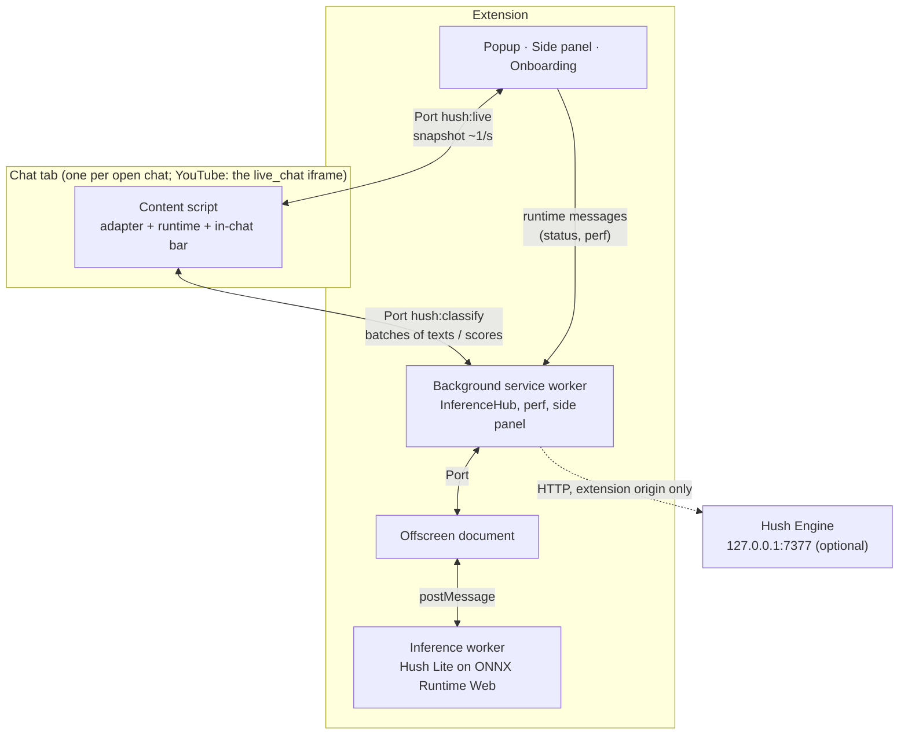
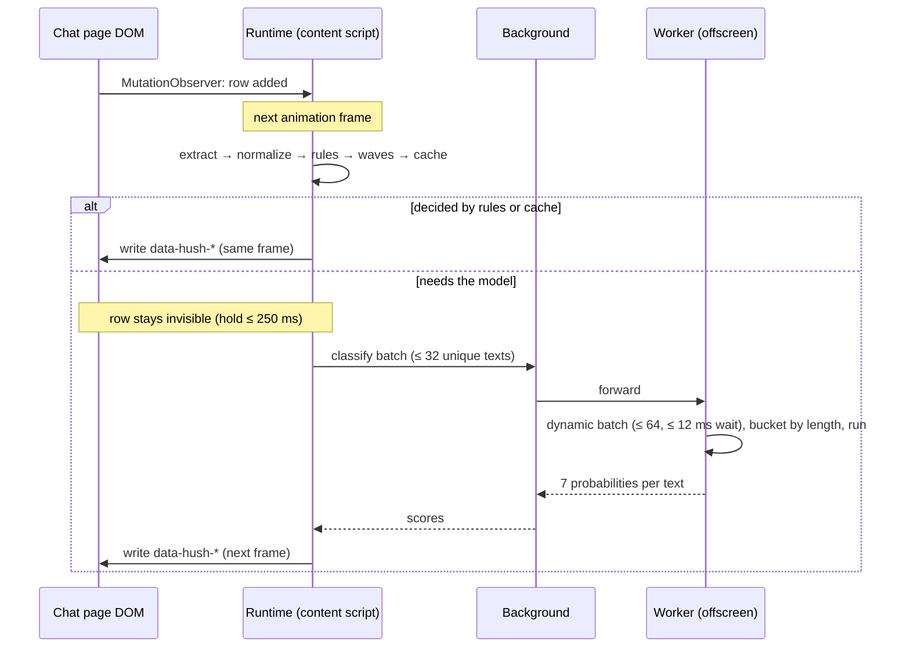

# Hush architecture

How a chat message gets from the page to a verdict, and why each piece is built the way it is. [SPEC.md](../SPEC.md) is the contract; this page describes the implementation. File paths are relative to `extension/src/` unless they say otherwise.

## Processes

- **One model for all tabs.** The model lives in a single offscreen document (Chrome allows one per extension), inside a module worker. Ten open chats share one model, one score cache and one batch queue.
- **Nothing heavy on the page.** The content script does DOM work, cheap rules and bookkeeping. Inference never runs on the page's main thread.
- **The service worker is disposable.** Chrome kills MV3 service workers after about 30 seconds idle. The background keeps no state that matters: content scripts reconnect their Port with backoff, the offscreen document reconnects when asked (`MSG_OFFSCREEN_HELLO`) or is re-created, and the last model status is mirrored in `chrome.storage.session` so a restarted worker answers at once.

## Life of a message

### 1. Observe

`runtime/engine.ts` attaches one `MutationObserver` to the chat list the adapter points at, `childList` only. New rows go into a queue; nothing else happens in the observer callback. While the runtime filters, the list carries `data-hush-list`, and the stylesheet hides any row of that list that has no verdict attribute yet. So rows are invisible from birth without a write per row, and there is no flash of unfiltered text even for rows inserted during the page's own animation frame.

### 2. Read phase (once per frame)

For each queued row:

1. **Extract** (`platforms/*.ts`). The adapter turns the row into a `ChatMessage` (`core/types.ts`): author, role bitmask, text with emote images replaced by their codes, emote count, mentions, reply and first-message flags, paid flag. System rows (raids, "welcome to chat", membership banners without text) return `null` and are left alone.
2. **Normalize** (`core/normalize.ts`). NFKC (only for non-ASCII), lowercase, drop zero-width, bidi, tag and variation-selector characters and zalgo, fold Cyrillic and Greek lookalikes inside mixed-script words, fold leetspeak in mostly-letter words, collapse character runs to two and token runs to three, mask `@mentions`. Pure non-Latin words are never folded (Bulgarian `сос` stays `сос`). The result is the cache key and what rules and waves see; the model sees the original text, only whitespace-collapsed.
3. **Rules** (`core/rules.ts`, Tier 0). Either a decision without the model, or signals for the policy:
   - decide: your block / allow / highlight rules (word, regex, user), `!commands` → noise, the same user repeating within 30 s → spam, ASCII art and character floods → spam, 10+ emotes → spam, repeated tokens → spam, emote-only and trivially short lines → noise, known scam patterns and links with scam words or from first-time chatters → scam;
   - signal: untrusted link (scam +0.3), allow-listed link (scam −0.25), scam words (+0.2), repeats (spam +0.2), caps (spam +0.1), question mark (fallback question);
   - protect: broadcaster, moderators and VIPs (setting), paid messages, mentions of the viewer.
4. **Waves** (`core/waves.ts`). A wave is at least 4 different users posting near-identical text within 10 s. Short messages match on the set of their normalized tokens ("KEKW", "KEKW KEKW" and "kekw" are one wave); longer ones (24+ characters) on a 64-bit SimHash of character 3-grams, indexed by 8 bands of 8 bits, verified by Hamming distance ≤ 9, so copypasta with small edits joins its wave. The first message becomes the head with a live `×N` counter; later ones are members and fold into it. Memory is bounded (clusters expire after 10 s of silence, at most 4,096).
5. **Cache.** A 5,000-entry LRU of normalized text → scores in the content script answers repeats instantly.
6. Anything still undecided is queued for the classifier, and the row is held if the current settings could hide it (`modelCanHide`): at most `holdMs` (default 250 ms).

### 3. Resolve

Scores that arrived since the last frame are matched to their rows. Late model verdicts are coalesced with the page's next rendering frame (above 20 msg/s) instead of forcing an extra style recalculation each. Held rows whose deadline passed are shown with a provisional verdict (rules only) and re-evaluated when their score lands, so they can still fold later. Failed batches fall back to rules.

### 4. Policy (`core/policy.ts`)

1. **Thresholds.** Per-label thresholds come from the model (`config.json` → `hush.thresholds`, calibrated on the gold set). The strictness slider shifts the thresholds of the filtering labels (toxic, spam, scam, noise, negative) in logit space by up to ±1.5.
2. **Category.** Rule signals nudge the scores, then the first label at or above its threshold in priority order wins: toxic > scam > spam > noise > question > negative > positive. None → clean.
3. **Action.** The category maps to the action in the current settings (`show`, `highlight`, `dim`, `collapse`, `hide`). User rules override: block → hide, allow → show. Wave members fold into their head unless an allow rule says otherwise. Protected messages are capped at show / highlight.

The `Verdict` carries category, action, a short reason (`toxic 0.94`, `wave ×37`, `link · first message`) and its source (`rule`, `cache`, `model`, `user`, `engine`).

### 5. Write phase

Only attribute diffs, in one pass, on the row element:

| Attribute | Meaning |
|---|---|
| `data-hush-a` | action: `show`, `highlight`, `dim`, `collapse`, `hide` |
| `data-hush-c` | category |
| `data-hush-r` | reason, shown on hover |
| `data-hush-wh` / `data-hush-wm` | wave head (with count) / wave member |
| `data-hush-open` | the viewer expanded a folded row |

All visuals come from one injected stylesheet (`runtime/styles.ts`, with the message decorations from `ui/decorations.ts`) made of plain attribute selectors and `--hush-*` custom properties. No inline styles, no layout reads, no `:is()` row scoping or sibling combinators: in the stress harness each of those multiplied style-recalculation cost (see [stress results](../extension/tests/stress/RESULTS.md#findings)).

### 6. Flush

The classifier batch goes over the Port, and the reactive store (`core/store.ts`, Preact signals) that the in-chat bar reads is updated at most 4 times per second in one `batch()`. Rows are tracked in a `WeakMap`; a row whose content changes (a recycled node) is evaluated again.

## Inference

### Routing (`inference/hub.ts`, background)

The hub assigns each content batch a global id, forwards it to the offscreen document and routes scores back to the right Port. It creates the offscreen document on demand, queues up to 8,192 texts while it starts, and broadcasts model status to the popup and side panel.

### Worker (`inference/worker.ts`, `engine.ts`, `batcher.ts`, `bucketing.ts`)

- **Dynamic batching.** Identical normalized texts from any tab share one slot. A flush happens at 64 unique texts or 12 ms after the oldest one arrived. One forward pass runs at a time; texts that arrive meanwhile form the next batch, so the batch size follows the load by itself.
- **Length bucketing.** Chat is mostly 3 to 15 tokens with a tail to 64. A small dynamic program splits each flush into length groups that minimize padded tokens plus a per-call overhead (large on WebGPU, where kernel dispatch dominates; small on WASM).
- **Cache.** 20,000 normalized texts → scores, shared by every tab.
- **Backpressure.** Above 4,096 queued texts new ones are rejected and their rows fall back to rules.
- **Idle.** After 10 minutes without requests the model is released and the offscreen document terminates the worker (WASM memory never shrinks); the next request starts a new one.

### Model loading (`inference/model.ts`, `config.ts`)

1. The worker tries the bundled copy (`models/hush-lite/`) and then the remote URL, and uses the first `config.json` it can load. Its `hush` block lists labels, thresholds, max length, files per variant and their sizes.
2. Backend: WebGPU if the adapter is usable and "Use the GPU" is on, otherwise WASM. Variant preference is `q8` for WebGPU and `uint8` for WASM, with fallbacks (see [inference benchmark](../extension/tests/bench/RESULTS.md)). fp16 variants need `shader-f16`.
3. The tokenizer (Transformers.js) and the ONNX file download in parallel with progress reporting. Remote files are cached in Cache Storage keyed by URL and model version; other versions are pruned.
4. The session is created with ONNX Runtime Web from the extension's own `ort/` files (MV3 allows no remote code) and warmed up on four batch shapes. Non-finite outputs (fp16 overflow, a broken execution provider) count as a failure and trigger the next variant or backend.
5. Extension pages are cross-origin isolated (COOP `same-origin`, COEP `credentialless`) so the WASM backend can use threads: up to 4, or half the cores.

## Platform adapters

Each adapter (`platforms/types.ts`) finds the chat list, extracts rows, reports the theme and, where possible, the signed-in viewer. Their header comments record the live DOM they were written against.

| Platform | Where the chat lives | Quirks |
|---|---|---|
| YouTube | `live_chat` iframe (also popout and replay), Polymer light DOM | The element id is the message id. Paid messages, stickers and memberships are separate renderers. |
| Twitch | channel page, popout, embed, moderator view | No message id in the DOM, so the key is a content hash. 7TV replaces the whole list with its own (handled); FrankerFaceZ and BTTV lines are handled too. |
| Kick | channel page and popout, React | The list is virtualized: only about 30 rows are mounted, and rows scrolled away are unmounted and re-mounted as new nodes. Keys are content hashes so a re-mounted row keeps its verdict. |

Content-script injection targets are in `platforms/matches.ts`. Twitch and Kick are single-page apps, so the runtime re-checks `adapter.matches()` on navigation.

## UI surfaces

- **In-chat bar** (`ui/bar/`): mounted in a shadow root above the chat, so page CSS and Hush CSS never meet. It reads a frame-aligned, rate-limited mirror of the store (`view.ts`: counters at 4 fps, charts and status at most 1 fps) and animates only opacity and transform.
- **Popup** and **side panel** (`ui/popup/`, `ui/sidepanel/`) are extension pages. They read settings from `chrome.storage.local`, model status and perf from the background, and live data from the active chat tab over a `hush:live` Port (one snapshot about every second while open).
- **Onboarding** (`ui/onboarding/`) opens on install, shows model download progress and lets the viewer pick a preset.

## Hush Engine

The optional engine (`engine/`) is a FastAPI server in front of llama.cpp running Clef-Flash. The extension calls it only from the background service worker: the engine accepts extension and localhost origins and nothing else, and a content script's requests carry the page's origin. See [engine/README.md](../engine/README.md) for its API, scheduling (LIFO under load, per-request deadlines, dedup, adaptive concurrency) and security model.

<!-- TODO(lead): describe the extension-side engine client (src/engine-client) here once it lands: which texts are sent, deadlines, how follow-up answers change verdicts. -->

## Testing

| Layer | How |
|---|---|
| Core logic | vitest unit tests: normalize, rules, waves, policy, LRU, runtime with fake adapters and a fake classifier |
| Adapters | saved, sanitized HTML fixtures of all three sites (with 7TV), loaded in happy-dom |
| Inference | batcher, bucketing, engine with a fake model, hub routing with fake Ports |
| UI | vitest for the bar and decorations; a showcase app renders every surface on mock data for screenshots |
| Performance | Playwright stress harness: mock Twitch / YouTube chats fed with real chat lines at 10 to 200 msg/s, Hush paused vs. running in alternating windows ([results](../extension/tests/stress/RESULTS.md)) |
| Model speed | Playwright inference benchmark of every ONNX variant on WebGPU and WASM ([results](../extension/tests/bench/RESULTS.md)) |
| Engine | pytest with an in-process fake backend and a fake `llama-server` process; integration tests against a real one |
