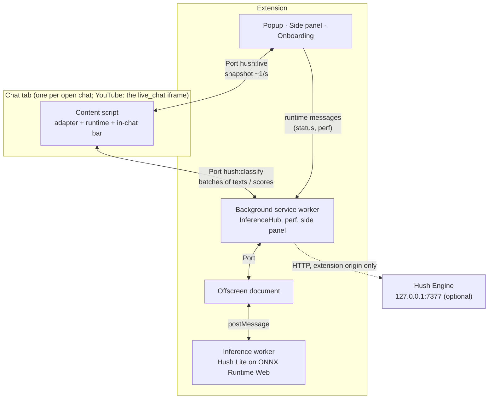
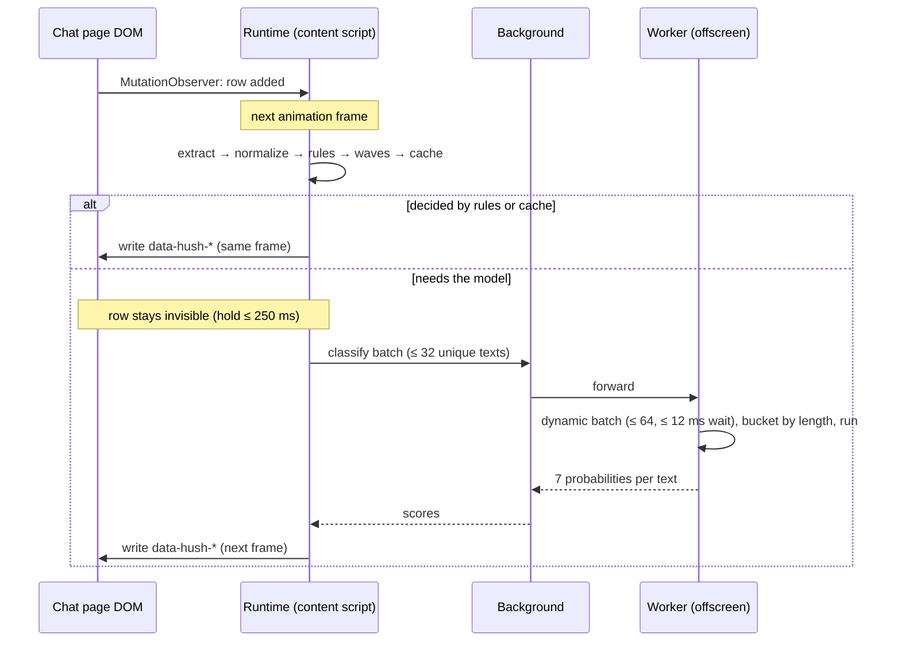
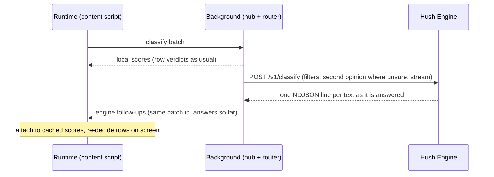

# Hush architecture

How a chat message gets from the page to a verdict, and why each piece is built the way it is. [SPEC.md](../SPEC.md) is the contract; this page describes the implementation. File paths are relative to `extension/src/` unless they say otherwise.

## Processes

- **One model for all tabs.** The model lives in a single offscreen document (Chrome allows one per extension), inside a module worker. Ten open chats share one model, one score cache and one batch queue.
- **Nothing heavy on the page.** The content script does DOM work, cheap rules and bookkeeping. Inference never runs on the page's main thread.
- **Open chats are picked up on install and update.** Chrome injects content scripts only into pages loaded after an install, and an update cuts the running copies off from the extension (they notice and stop). So on install and update the background injects the content script into the chat frames of open YouTube, Twitch and Kick tabs (`chrome.scripting`). A frame that ends up with two copies runs only the newer one.
- **The service worker is disposable.** Chrome kills MV3 service workers after about 30 seconds idle. The background keeps no state that matters: content scripts reconnect their Port with backoff, the offscreen document reconnects when asked (`MSG_OFFSCREEN_HELLO`) or is re-created, and the last model status is mirrored in `chrome.storage.session` so a restarted worker answers at once.

## Life of a message

### 1. Observe

`runtime/engine.ts` attaches one `MutationObserver` to the chat list the adapter points at, `childList` only. New rows go into a queue; nothing else happens in the observer callback. While the runtime filters, the list carries `data-hush-list`, and the stylesheet hides any row of that list that has no verdict attribute yet. So rows are invisible from birth without a write per row, and there is no flash of unfiltered text even for rows inserted during the page's own animation frame.

### 2. Read phase (once per frame)

For each queued row:

1. **Extract** (`platforms/*.ts`). The adapter turns the row into a `ChatMessage` (`core/types.ts`): author, role bitmask, text with emote images replaced by their codes, emote count, mentions, reply and first-message flags, paid flag. System rows (raids, "welcome to chat", membership banners without text) return `null` and are left alone.
2. **Normalize** (`core/normalize.ts`). NFKC (only for non-ASCII), lowercase, drop zero-width, bidi, tag and variation-selector characters and zalgo, fold Cyrillic and Greek lookalikes inside mixed-script words, fold leetspeak in mostly-letter words, collapse character runs to two and token runs to three, mask `@mentions`. Pure non-Latin words are never folded (Bulgarian `сос` stays `сос`). The result is the cache key and what rules and waves see. The model sees the original text, lightly cleaned (`cleanForModel`): invisible characters dropped, zalgo stacks squashed, blanks collapsed to one space, at most 400 characters; case, script, emoji and character runs are kept, as in training. `ml/train/textclean.py` is the same function in Python, so training, the gold evaluation and the thresholds see the same input as the browser.
3. **Rules** (`core/rules.ts`, Tier 0). Either a decision without the model, or signals for the policy:
   - decide: your block / allow / highlight rules (word, regex, user), `!commands` → noise, the same user repeating within 30 s → spam, ASCII art and character floods → spam, 10+ emotes → spam, repeated tokens → spam, emote-only and trivially short lines → noise, known scam patterns and links with scam words or from first-time chatters → scam;
   - signal: untrusted link (scam +0.3), allow-listed link (scam −0.25), scam words (+0.2), repeats (spam +0.2), caps (spam +0.1), question mark (fallback question);
   - protect: broadcaster, moderators and VIPs (setting), paid messages (bits, Super Chats, Kicks, sub messages), the viewer's own messages (never a repeat either) and mentions of the viewer by login or display name. The viewer is known on YouTube and Twitch when signed in, not on Kick.
4. **Waves** (`core/waves.ts`). A wave is at least 4 different users posting near-identical text within 10 s. Short messages match on the set of their normalized tokens ("KEKW", "KEKW KEKW" and "kekw" are one wave); longer ones (24+ characters) on a 64-bit SimHash of character 3-grams, indexed by 8 bands of 8 bits, verified by Hamming distance ≤ 9, so copypasta with small edits joins its wave. The first message becomes the head with a live `×N` counter; later ones are members and fold into it. Memory is bounded (clusters expire after 10 s of silence, at most 4,096).
5. **Cache.** A 5,000-entry LRU of normalized text → scores in the content script answers repeats instantly.
6. Anything still undecided is queued for the classifier, and the row is held if the current settings could hide it (`modelCanHide`): at most `holdMs` (default 250 ms).

### 3. Resolve

Scores that arrived since the last frame are matched to their rows. Late model verdicts are coalesced with the page's next rendering frame (above 20 msg/s) instead of forcing an extra style recalculation each. Held rows whose deadline passed are shown with a provisional verdict (rules only) and re-evaluated when their score lands, so they can still fold later. Failed batches fall back to rules. Hush Engine answers arrive later still (see [below](#extension-side-engine-client-background)): the rows already showing an answered text are decided again in the same pass, so a custom filter can hide a message that is on screen.

### 4. Policy (`core/policy.ts`)

1. **Thresholds.** Per-label thresholds come with the model file in use, calibrated on the gold set for that student (`config.json` → `hush.variant_thresholds[variant]`, else `hush.thresholds`), and reach the content script in the model status. The strictness slider shifts the thresholds of the filtering labels (toxic, spam, scam, noise, negative) in logit space by up to ±1.5.
2. **Category.** Rule signals nudge the scores, then the first label at or above its threshold in priority order wins: toxic > scam > spam > noise > question > negative > positive. None → clean.
3. **Action.** The category maps to the action in the current settings (`show`, `highlight`, `dim`, `collapse`, `hide`). A Hush Engine custom filter that fired raises the action when its own is stronger. User rules override both: block → hide, allow → show. Wave members fold into their head unless an allow rule says otherwise. Protected messages are capped at show / highlight.

The `Verdict` carries category, action, a short reason and its source (`rule`, `cache`, `model`, `user`, `engine`). The reason is written for people, because the hover chip and the side panel log show it as is: `toxic · 94%` (the winning label's probability), `scam · link` (a rule signal carried the label over its threshold), `wave ×37`, `filter: backseating`, `repeat ×8`, `link · first message`.

### 5. Write phase

Only attribute diffs, in one pass, on the row element:

| Attribute | Meaning |
|---|---|
| `data-hush-a` | action: `show`, `highlight`, `dim`, `collapse`, `hide` |
| `data-hush-c` | category |
| `data-hush-r` | reason, shown on hover |
| `data-hush-wh` / `data-hush-wm` | wave head (with count) / wave member |
| `data-hush-run` | on the last folded row of a run: the run's length. That row draws the "3 hidden · show" pill and is a button for the keyboard and screen readers (`tabindex`, `role`, `aria-label`; Enter or Space opens it). The run's other folded rows take no space. |
| `data-hush-open` | the viewer expanded a folded row |

All visuals come from one injected stylesheet (`runtime/styles.ts`, with the message decorations from `ui/decorations.ts`) made of plain attribute selectors and `--hush-*` custom properties. No inline styles, no layout reads, no `:is()` row scoping or sibling combinators: in the stress harness each of those multiplied style-recalculation cost (see [stress results](../extension/tests/stress/RESULTS.md#findings)).

### 6. Flush

The classifier batch goes over the Port, and the reactive store (`core/store.ts`, Preact signals) that the in-chat bar reads is updated at most 4 times per second in one `batch()`. Rows are tracked in a `WeakMap`; a row whose content changes (a recycled node) is evaluated again. What was decided about the last 1,024 messages is also kept by message key, across Hush being turned off and on: a message that comes back in a new node (Kick re-mounts rows scrolled back into view, YouTube re-renders the list on a chat-mode switch) keeps its verdict, wave role and "show" click, and is not counted, logged or fed to the duplicate rule and waves again.

## Inference

### Routing (`inference/hub.ts`, background)

The hub assigns each content batch a global id, forwards it to the offscreen document and routes scores back to the right Port. It creates the offscreen document on demand, queues up to 8,192 texts while it starts, and broadcasts model status to the popup and side panel. A model that failed to load (the download broke, the worker crashed) is loaded again while any chat is open: after 5 s, then twice as long each time, up to 5 minutes, so it comes back without the viewer touching a setting. **Retry** in the popup or the side panel (`hush:reloadModel`) loads it again at once, with or without an open chat, and starts the backoff over. When Hush Engine is on, the hub also hands every batch of scores it sent back to the engine router ([below](#extension-side-engine-client-background)), with a flag for batches that came from a background tab.

### Worker (`inference/worker.ts`, `engine.ts`, `batcher.ts`, `bucketing.ts`)

- **Dynamic batching.** Identical normalized texts from any tab share one slot. A flush happens at 64 unique texts or 12 ms after the oldest one arrived. One forward pass runs at a time; texts that arrive meanwhile form the next batch, so the batch size follows the load by itself.
- **Length bucketing.** Chat is mostly 3 to 15 tokens with a tail to 64. A small dynamic program splits each flush into length groups that minimize padded tokens plus a per-call overhead (large on WebGPU, where kernel dispatch dominates; small on WASM).
- **Cache.** 20,000 normalized texts → scores, shared by every tab.
- **Backpressure.** When texts arrive faster than the model runs, each flush takes the newest ones first: their rows are the ones on screen. A queued text that nobody asked for again in the last 2 s is dropped at the next flush instead of making every later answer late too. Above 4,096 queued texts new ones are rejected. In both cases the rows keep their rules-only verdict.
- **Idle.** After 10 minutes without requests the model is released and the offscreen document terminates the worker (WASM memory never shrinks); the next request starts a new one.

### Model loading (`inference/model.ts`, `config.ts`, `integrity.ts`)

1. The worker tries the bundled copy (`models/hush-lite/`) and then, only in a build made with `WXT_HUSH_MODEL_URL`, that remote base URL, and uses the first `config.json` it can load. There is no default remote source: release zips bundle the model, and a build with neither has no model (rules only). The `hush` block of `config.json` lists labels, thresholds, max length, files per variant and their sizes, and, for a folder that combines two students, each file's layers and version (`variant_info`) and thresholds (`variant_thresholds`).
2. Backend: WebGPU if the adapter is usable and "Use the GPU" is on, otherwise WASM. Variant preference is `q8` for WebGPU and `uint8` for WASM, with fallbacks (see [inference benchmark](../extension/tests/bench/RESULTS.md)). fp16 variants need `shader-f16`. In the shipped folder the two defaults are different students: `q8` is the 6-layer one, `uint8` the 3-layer one, because WASM has far less compute to spend per message. Each user downloads or loads only the file for their backend.
3. The tokenizer (Transformers.js) and the ONNX file load in parallel with progress reporting. Files from a remote base must match the SHA-256 and size pinned in the build (`REMOTE_MODEL_PINS`, computed from the model folder by `modules/hush-inference.ts` at build time); an unpinned or different file is refused, so the host can break the download but cannot change the model or its thresholds. The tokenizer and the ONNX file are cached in Cache Storage keyed by URL and pinned hash, and cached files the build does not pin are pruned. Bundled files are part of the extension package and need no pin.
4. The session is created with ONNX Runtime Web from the extension's own `ort/` files (MV3 allows no remote code) and warmed up on four batch shapes. Non-finite outputs (fp16 overflow, a broken execution provider) count as a failure and trigger the next variant or backend. If WebGPU fails twice in a row while running (a lost device), the worker reloads the model on WASM.
5. Scores are only valid with the thresholds of the model that produced them. When another student is loaded (the GPU setting changed, WebGPU was lost), the worker's and the content scripts' score caches start empty, a forward pass that straddled the switch is run again, and the rows on screen are scored again by the new model.
6. Extension pages are cross-origin isolated (COOP `same-origin`, COEP `credentialless`) so the WASM backend can use threads: up to 4, or half the cores.

## Platform adapters

Each adapter (`platforms/types.ts`) finds the chat list, extracts rows, reports the theme and, where possible, the signed-in viewer. Their header comments record the live DOM they were written against.

| Platform | Where the chat lives | Quirks |
|---|---|---|
| YouTube | `live_chat` iframe (also popout and replay), Polymer light DOM | The element id is the message id. Paid messages, stickers and memberships are separate renderers. |
| Twitch | channel page, popout, embed, moderator view | No message id in the DOM, so the key is a content hash. 7TV replaces the whole list with its own (handled); FrankerFaceZ and BTTV lines are handled too. |
| Kick | channel page and popout, React | The list is virtualized: only about 30 rows are mounted, and rows scrolled away are unmounted and re-mounted as new nodes. Keys are content hashes so a re-mounted row keeps its verdict. |

Content-script injection targets are in `platforms/matches.ts`. Twitch and Kick are single-page apps, so the runtime re-checks `adapter.matches()` on navigation.

## UI surfaces

- **In-chat bar** (`ui/bar/`): mounted in a shadow root above the chat, so page CSS and Hush CSS never meet. It reads a frame-aligned, rate-limited mirror of the store (`view.ts`: counters at 2 fps, charts and stats at most 1 fps, nothing while the tab is hidden) and animates only opacity and transform.
- **Popup** and **side panel** (`ui/popup/`, `ui/sidepanel/`) are extension pages. They read settings from `chrome.storage.local`, model status and perf from the background, and live data from the active chat tab over a `hush:live` Port (one snapshot about every second while open).
- **Onboarding** (`ui/onboarding/`) opens on install, shows model download progress and lets the viewer pick a preset.

## Hush Engine

The optional engine (`engine/`) is a FastAPI server in front of llama.cpp running Clef-Flash. The extension calls it only from the background service worker: the engine accepts extension and localhost origins and nothing else, and a content script's requests carry the page's origin. In managed mode the engine starts its own `llama-server` and locks it with a random API key made up on every run, because llama-server checks neither `Origin` nor `Host`. See [engine/README.md](../engine/README.md) for its API, scheduling (LIFO under load, per-request deadlines, dedup, adaptive concurrency) and security model.

### Extension side (`engine-client/`, background)

- **Which texts.** `router.ts` sees every batch of local scores the hub sends back to a tab, so only texts that reached the in-browser model: rule decisions and content-side cache hits never go to the engine. Batches from a chat in a background tab are skipped too (the content script marks them `hidden`): their rows have usually scrolled away before anyone looks, and the engine's capacity is far below a busy chat's rate. Every enabled custom filter is asked about every such text. The second opinion (the engine's own scores) is asked only when `isUnsure()` in `core/policy.ts` says so: a label whose action would dim, fold or hide is within 1.1 logits (about 3× odds) of its threshold. A text with neither is not sent. The stream context the viewer typed for the tab's channel goes along.
- **Requests.** `client.ts` groups texts with the same filters, second-opinion flag and context into `POST /v1/classify` requests of up to 32 texts, waits at most 50 ms to fill one, and keeps at most 4 in flight. Requests ask for a streamed answer (`stream: true`): the engine writes one NDJSON line per text as soon as it is answered, so each text settles when its own answer is in, not when the slowest one of its request is (an engine that cannot stream answers with one JSON for the whole request). Every text has 2.5 s from the moment it is asked: one with less than 250 ms left is dropped unsent, each request tells the engine its remaining budget (`deadline_ms`) and is aborted shortly after it. Under load the newest texts go first, since they are the ones on screen. Answers are cached (2,000 texts), so the same text from several tabs costs one request. Health is polled only while the engine is enabled (every 10 s when ready, 2 s while it loads, backing off from 2 s to 30 s while nothing answers), and nothing is asked until it is ready.
- **Follow-up.** The router posts answers to the tab's Port as they come in, as `engine` messages: the batch id, the ids answered so far, a probability per filter and, where asked, the engine's scores. A text that gets no answer in time is simply left out. One slow text does not hold back the others, and answers that arrive close together share a message: the first after a quiet spell goes out at once, later ones at most every 50 ms per Port, so a busy chat does not cost the tab a message and a re-decide pass per text. The content script's `ClassifierClient` attaches the answers to the cached score vector of each text (`ScoreVector.engine`), so every row and every later cache hit of that text sees them, and calls the runtime's `onRescored`. In its next resolve pass the runtime decides again every live row that shows one of those texts.
- **Policy.** A filter at 0.5 or more applies its action when that is stronger than the category's action, never milder, and the reason becomes `filter: <name>`. With "second opinion" on, the engine's scores are averaged with the local ones in logit space, each measured against its own model's thresholds, and the verdict's source becomes `engine`. The engine's thresholds (`ENGINE_THRESHOLDS` in `core/policy.ts`) are calibrated on the gold set's teacher scores: Clef-Flash's softmax puts many clean messages above the in-browser model's thresholds, so its raw scores are never compared with those. User rules and protected authors win as always.

## Testing

| Layer | How |
|---|---|
| Core logic | vitest unit tests: normalize, rules, waves, policy, LRU, runtime with fake adapters and a fake classifier |
| Adapters | saved, sanitized HTML fixtures of all three sites (with 7TV), loaded in happy-dom |
| Inference | batcher (dedup, newest first, expiry, backpressure), bucketing, engine with a fake model, switching students, pinned-hash checks, hub routing and load retries with fake Ports |
| Engine client | router and client against a fake engine (batching, deadlines, follow-ups, background tabs), policy with engine answers, runtime re-deciding rows on a late answer |
| UI | vitest for the bar, decorations, pill runs, the live bridge to the popup and side panel, and the extension pages; a showcase app renders every surface on mock data for screenshots |
| Performance | Playwright stress harness: mock Twitch / YouTube chats fed with real chat lines at 10 to 200 msg/s, Hush paused vs. running in alternating windows ([results](../extension/tests/stress/RESULTS.md)) |
| Model speed | Playwright inference benchmark of every ONNX variant on WebGPU and WASM ([results](../extension/tests/bench/RESULTS.md)) |
| Engine | pytest with an in-process fake backend and a fake `llama-server` process; integration tests against a real one |
