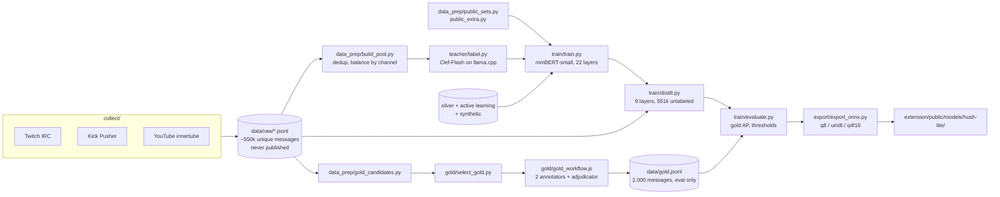

# Hush ML pipeline

Everything that produces **Hush Lite**, the in-browser chat classifier: chat collection, labeling, training, distillation, threshold calibration and ONNX export. Results, data sources and limitations are in the [model card](../docs/MODEL_CARD.md).



## Setup

Python 3.10+ and an NVIDIA GPU with CUDA for training, distillation and the teacher. Everything was built on one RTX 3090. There is no lock file yet; these are the versions used:

```sh
cd ml
python -m venv .venv
.venv/Scripts/python -m pip install torch==2.11.* --index-url https://download.pytorch.org/whl/cu128
.venv/Scripts/python -m pip install "transformers==5.19.*" "datasets==5.1.*" "tokenizers==0.23.*" safetensors \
    "scikit-learn==1.9.*" numpy aiohttp "onnx==1.23.*" "onnxruntime-gpu==1.31.*" onnxslim
```

(On Linux and macOS the interpreter is `.venv/bin/python`.) Run every script from `ml/`: relative paths such as `data/gold.jsonl` and `runs/v2/best` resolve against it.

## Data

`ml/data/`, `ml/runs/` and `ml/out/` are git-ignored. **Raw chat logs are never committed or published**: they contain public usernames and are used only to build training data. Everything below is JSON Lines, one message per line.

| File | Rows | Contents |
|---|---|---|
| `data/raw/<platform>_<time>.jsonl` | | collector output: `text`, `p` (platform), `ch`, `lang` (channel's stream language), `u`/`uid`, `badges`, `emotes`, `reply`, `ts`, plus moderator events (deletions, timeouts, bans) |
| `data/pool_v*.jsonl` | | deduplicated, channel-balanced messages to label |
| `data/teacher.jsonl` | `t`: teacher probabilities for the 7 labels plus `clean` | Clef-Flash soft labels |
| `data/public.jsonl`, `data/public_extra.jsonl` | `y`: labels a source knows; the others are masked | public datasets mapped to Hush labels |
| `data/silver*.jsonl`, `data/synth*.jsonl` | `y`: 0/1 for all 7 labels | agent-labeled real chat, synthetic hard cases |
| `data/gold.jsonl` | `y` + `agree` | the evaluation set, never trained on |

## 1. Collect

All three collectors read public chat without logging in (no account, no API key) and write to `data/raw/`:

```sh
python collect/twitch_irc.py --minutes 180 --top 90        # IRC; top live channels + extra languages, re-picked every 20 min
python collect/kick_pusher.py --minutes 180 --channels 60  # public Pusher websocket
python collect/youtube_live.py --minutes 150 --streams 30  # innertube live chat; streams found via search in many languages
```

Moderator actions are recorded as weak labels: a message deleted by a moderator, or sent shortly before its author was timed out or banned, gets oversampled into the labeling pool.

## 2. Pool and teacher labels

```sh
python data_prep/build_pool.py --glob "*.jsonl" --per-channel 4000 --out data/pool_v2.jsonl
```

The teacher is [Cloudflare Clef-Flash](https://huggingface.co/Cloudflare/clef-flash), a 9B decision model, served by llama.cpp's `llama-server` and its `/v1/systemone` decision endpoint. The engine's downloader fetches both (see [engine/README.md](../engine/README.md)):

```sh
../engine/start.ps1 --download-only     # or ../engine/start.sh; fills engine/vendor/
../engine/vendor/llama.cpp/llama-server -m ../engine/vendor/models/clef-flash/Clef-Flash-Q8_0.gguf \
    --host 127.0.0.1 --port 7378 -a clef-flash -ngl 99 -np 16 -c 16384 -ub 1024 -b 1024
python teacher/probe.py                                     # sanity check on 15 messages
python teacher/label.py data/pool_v2.jsonl data/teacher.jsonl --workers 24
```

`label.py` asks two questions per message: a 6-way category (`clean, question, noise, spam, scam, toxic`) and a 3-way tone (`positive, neutral, negative`), about 350 prompt tokens. It is resumable (texts already in the output are skipped) and ran at 6 to 10 messages per second on the 3090 while it shared the GPU with training.

## 3. Public data

```sh
python data_prep/public_sets.py    # civil_comments, toxi-text-3M, telegram spam, discord scam, all-scam-spam, UCI YouTube spam
python data_prep/public_extra.py   # discord scam again (retry) + clapAI/MultiLingualSentiment
```

Only permissively licensed sets are used (CC0, Apache-2.0, MIT, WTFPL, CC BY 4.0 with attribution); the table with licenses is in the model card. Each source supervises only the labels it actually knows; the rest are masked in the loss. Note: `tyqiangz/multilingual-sentiments`, listed in `public_sets.py`, no longer loads with current `datasets` and contributes nothing; sentiment comes from clapAI.

## 4. Gold set

```sh
python data_prep/gold_candidates.py --n 6000                              # unseen messages, all platforms, spread over languages
python teacher/label.py data/gold_candidates.jsonl data/gold_teacher.jsonl   # teacher scores, for stratification
python gold/select_gold.py --n 2000 --chunk 200                           # oversample rare labels, write gold/workflow_args.json
```

`gold/gold_workflow.js` is a Claude agent workflow script: two annotators label every chunk independently with the written guideline in the file, and an adjudicator decides every message they disagree on. Its output, merged with `gold_selected.jsonl`, is `data/gold.jsonl` (2,000 messages, 92% full agreement). The annotators see the message text, platform and stream language, never the author.

## 5. Silver, active learning, synthetic

These sets were made outside the scripts in this repo, and their selection and merge steps are **not scripted here yet**:

- `data/silver.jsonl`: about 12k real messages from the pool, labeled by Claude agents with the gold guideline (input chunks in `data/silver_chunks/`).
- `data/silver2.jsonl`: about 5.8k messages where the v1 student was most uncertain (active learning), labeled the same way.
- `data/synth_v1.jsonl`, `data/synth_v2.jsonl`: about 3.6k written hard cases in 28 languages (harmful vs. similar harmless messages, leetspeak, Bulgarian in Cyrillic and Latin script, profanity without a target).

## 6. Train

```sh
python train/train.py --out runs/v2 --epochs 4 --silver "data/silver*.jsonl"
```

mmBERT-small with a 7-way multi-label head. Teacher rows give soft targets for all labels, silver rows count 3x, public rows 0.5x, synthetic rows are repeated twice; `toxic` and `scam` get 2x loss weight. Every epoch is scored against the teacher-labeled validation split and against the gold set, and the best gold epoch is saved to `runs/<name>/best`. About 16 minutes on the 3090.

## 7. Distill

```sh
python train/distill.py --teacher runs/v2/best --blocks 0,3,6 --out runs/v2-9L    # 9 layers (shipped)
python train/distill.py --teacher runs/v2/best --blocks 0,6 --out runs/v2-6L      # 6 layers (layers 0-2 and 18-20)
```

The student keeps whole blocks of three layers from the teacher (ModernBERT alternates one global-attention layer with two local ones). It learns the teacher's probabilities on every unique real message in `data/raw/` (about 551k) plus the labeled rows, where the hard label is mixed 50/50 with the teacher's probability. About 12 minutes for 9 layers.

## 8. Evaluate and calibrate

```sh
python train/evaluate.py runs/v2-9L/best --teacher data/gold_teacher.jsonl          # report only
python train/evaluate.py runs/v2-9L/best --teacher data/gold_teacher.jsonl --write  # also store thresholds in config.json
```

Prints AP, F1, precision and recall per label, macro numbers and per-language macro F1 for three cases: the student at 0.5, the student with thresholds calibrated on one half of the gold set and scored on the other, and the teacher. Thresholds maximize F-beta per label, with beta 0.7 for `toxic`, `spam` and `scam` (precision first) and 1 for the rest. `--write` fits them on the whole gold set and stores them as `hush.thresholds`; the export carries them into the extension.

## 9. Export

```sh
python export/export_onnx.py --model runs/v2-9L/best --out ../extension/public/models/hush-lite \
    --precisions q8,uint8,q4f16 --model-version v2-9L
```

The exporter re-expresses ModernBERT with ONNX Runtime's fused `RotaryEmbedding` and `MultiHeadAttention` ops (`export/fused_modernbert.py`; for the 22-layer model that is 466 graph nodes instead of 1,404, and every node is a kernel dispatch on WebGPU), quantizes, and checks every file against PyTorch on real chat lines. It writes `hush_export.json` with sizes and parity (mean probability difference, share of flipped decisions). The file layout and how the extension picks a variant are described in [extension/README.md](../extension/README.md#the-model). After a tokenizer change, run `node tests/bench/tokenizer-parity.mjs` in `extension/` (after `node tests/bench/make-sample.mjs`): the browser tokenizer must match the Python one on real chat lines.

## Results so far

| Model | Gold macro AP |
|---|---|
| Teacher, Clef-Flash 9B | 0.721 |
| v0 | 0.627 |
| v1 (+ silver) | 0.778 |
| v2 (+ active learning), 22 layers | 0.816 |
| **v2-9L**, shipped | **0.822** |
| v2-6L | TODO(lead) |

Per-label numbers, calibrated thresholds and caveats: [model card](../docs/MODEL_CARD.md#evaluation).
