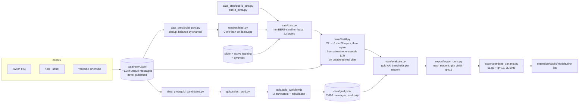

# Tiho ML pipeline

Everything that produces **Tiho Lite**, the in-browser chat classifier: chat collection, labeling, training, distillation, threshold calibration and ONNX export. Results, data sources and limitations are in the [model card](../docs/MODEL_CARD.md).



## Setup

Python 3.10+ and an NVIDIA GPU with CUDA for training, distillation and the teacher. Everything was built on one RTX 3090. There is no lock file yet; these are the versions used:

```sh
cd ml
python -m venv .venv
.venv/Scripts/python -m pip install torch==2.11.* --index-url https://download.pytorch.org/whl/cu128
.venv/Scripts/python -m pip install "transformers==5.19.*" "datasets==5.1.*" "tokenizers==0.23.*" safetensors \
    "scikit-learn==1.9.*" numpy aiohttp "onnx==1.23.*" "onnxruntime-gpu==1.31.*" onnxslim pytest
```

(On Linux and macOS the interpreter is `.venv/bin/python`.) Run every script from `ml/`: relative paths such as `data/gold.jsonl` and `runs/v2/best` resolve against it. Tests: `python -m pytest tests` (the check that `train/textclean.py` matches the extension needs Node.js 22).

The model reads every message the way the extension hands it over: `train/textclean.py` is a port of the extension's `cleanForModel` (invisible characters dropped, zalgo squashed, blanks collapsed, at most 400 characters), and training, distillation, evaluation and export parity all use it.

## Data

`ml/data/`, `ml/runs/` and `ml/out/` are git-ignored. **Raw chat logs are never committed or published**: they contain public usernames and are used only to build training data. Everything below is JSON Lines, one message per line.

| File | Rows | Contents |
|---|---|---|
| `data/raw/<platform>_<time>.jsonl` | | collector output: `text`, `p` (platform), `ch`, `lang` (channel's stream language), `u`/`uid`, `badges`, `emotes`, `reply`, `ts`, plus moderator events (deletions, timeouts, bans) |
| `data/pool_v*.jsonl` | | deduplicated, channel-balanced messages to label |
| `data/teacher.jsonl` | `t`: teacher probabilities for the 7 labels plus `clean` | Clef-Flash soft labels |
| `data/public.jsonl`, `data/public_extra.jsonl` | `y`: labels a source knows; the others are masked | public datasets mapped to Tiho labels |
| `data/silver*.jsonl`, `data/synth*.jsonl` | `y`: 0/1 for all 7 labels | agent-labeled real chat, synthetic hard cases |
| `data/gold_selected.jsonl` | `t`, `stratum`, `w` | which candidates became gold, why, and the inverse of their chance to be picked |
| `data/gold.jsonl` | `y` + `agree` | the evaluation set; `build_pool.py`, `train.py` and `distill.py` drop its texts from everything else |

## 1. Collect

All three collectors read public chat without logging in (no account, no API key) and write to `data/raw/`:

```sh
python collect/twitch_irc.py --minutes 180 --top 90        # IRC; top live channels + extra languages, re-picked every 20 min
python collect/kick_pusher.py --minutes 180 --channels 60  # public Pusher websocket
python collect/youtube_live.py --minutes 150 --streams 30  # innertube live chat; streams found via search in many languages
```

Moderator actions are recorded as weak labels: a message deleted by a moderator, or sent shortly before its author was timed out or banned, gets oversampled into the labeling pool.

## 2. Pool and teacher labels

```sh
python data_prep/build_pool.py --glob "*.jsonl" --per-channel 4000 --out data/pool_v2.jsonl
```

The teacher is [Cloudflare Clef-Flash](https://huggingface.co/Cloudflare/clef-flash), a 9B decision model, served by llama.cpp's `llama-server` and its `/v1/systemone` decision endpoint. The engine's downloader fetches both (see [engine/README.md](../engine/README.md)):

```sh
../engine/start.ps1 --download-only     # or ../engine/start.sh; fills engine/vendor/
../engine/vendor/llama.cpp/llama-server -m ../engine/vendor/models/clef-flash/Clef-Flash-Q8_0.gguf \
    --host 127.0.0.1 --port 7378 -a clef-flash -ngl 99 -np 16 -c 16384 -ub 1024 -b 1024
python teacher/probe.py                                     # sanity check on 15 messages
python teacher/label.py data/pool_v2.jsonl data/teacher.jsonl --workers 24
```

`label.py` asks two questions per message: a 6-way category (`clean, question, noise, spam, scam, toxic`) and a 3-way tone (`positive, neutral, negative`), about 350 prompt tokens. It is resumable (texts already in the output are skipped) and ran at 6 to 10 messages per second on the 3090 while it shared the GPU with training.

## 3. Public data

```sh
python data_prep/public_sets.py    # civil_comments, toxi-text-3M, telegram spam, discord scam, all-scam-spam, UCI YouTube spam
python data_prep/public_extra.py   # discord scam again (retry) + clapAI/MultiLingualSentiment
```

Only permissively licensed sets are used (CC0, Apache-2.0, MIT, WTFPL, CC BY 4.0 with attribution); the table with licenses is in the model card. Each source supervises only the labels it actually knows; the rest are masked in the loss. Note: `tyqiangz/multilingual-sentiments`, listed in `public_sets.py`, no longer loads with current `datasets` and contributes nothing; sentiment comes from clapAI.

## 4. Gold set

```sh
python data_prep/gold_candidates.py --n 5000                              # unseen messages, all platforms, spread over languages
python teacher/label.py data/gold_candidates.jsonl data/gold_teacher.jsonl   # teacher scores, for stratification
python gold/select_gold.py --n 2000 --chunk 200                           # oversample rare labels, write gold/workflow_args.json
```

`select_gold.py` first takes, per label, the candidates the teacher scored highest (up to a quota), then fills up with a uniform sample of the rest. It records each pick's `stratum` and weight `w` (1 for a quota pick, remaining candidates / random picks for the fill) in `data/gold_selected.jsonl`, so `evaluate.py` can weight gold back to the candidate pool. For the current gold set that is 1,090 quota picks and 910 random ones out of 3,910 (weight 4.3).

`gold/gold_workflow.js` is a Claude agent workflow script: two annotators label every chunk independently with the written guideline in the file, and an adjudicator decides every message they disagree on. Its output, merged with `gold_selected.jsonl`, is `data/gold.jsonl` (2,000 messages, 92% full agreement). The annotators see the message text, platform and stream language, never the author.

## 5. Silver, active learning, synthetic

These sets were made outside the scripts in this repo, and their selection and merge steps are **not scripted here yet**:

- `data/silver.jsonl`: about 12k real messages from the pool, labeled by Claude agents with the gold guideline (input chunks in `data/silver_chunks/`).
- `data/silver2.jsonl`: about 5.8k messages where the v1 student was most uncertain (active learning), labeled the same way.
- `data/synth_v1.jsonl`, `data/synth_v2.jsonl`: about 3.6k written hard cases in 28 languages (harmful vs. similar harmless messages, leetspeak, Bulgarian in Cyrillic and Latin script, profanity without a target).

## 6. Train

The flags v2 was trained with:

```sh
python train/train.py --out runs/v2 --epochs 4 --silver data/silver.jsonl data/silver2.jsonl \
    --public data/public.jsonl data/public_extra.jsonl --public-ratio 1.0 --public-w 0.3 --synth-repeat 2
```

mmBERT-small with a 7-way multi-label head. Teacher rows give soft targets for all labels, silver rows count 3x, public rows 0.3x (`--public-ratio 1.0` draws as many at random from both public files as there are teacher training rows), synthetic rows are repeated twice; `toxic` and `scam` get 2x loss weight. Gold texts are dropped from every source. Every epoch is scored against the teacher-labeled validation split and against the gold set, and the best gold epoch is saved to `runs/<name>/best`; the arguments go to `runs/<name>/args.json`. About 16 minutes on the 3090.

The command reproduces v2's recipe, not v2 itself: `data/teacher.jsonl` had 24.5k rows when v2 was trained (42k now), and the script has since learned to drop gold texts from public and synthetic data and to clean text like the extension.

The v3 teacher is the same recipe on mmBERT-base (307M parameters) with a lower learning rate, trained on all 42k teacher rows (38.7k for training, 3k for validation). It is too big to ship and is only used to distill the students (next section). About 16 minutes as well:

```sh
python train/train.py --base jhu-clsp/mmBERT-base --lr 3e-5 --out runs/v3-base --epochs 4 --silver data/silver.jsonl data/silver2.jsonl \
    --public data/public.jsonl data/public_extra.jsonl --public-ratio 1.0 --public-w 0.3 --synth-repeat 2
```

## 7. Distill

The shipped model is an adaptive pair: a 6-layer student for WebGPU and a 3-layer student for the CPU (WASM). The first students (v2) were distilled from the 22-layer v2:

```sh
python train/distill.py --teacher runs/v2/best --blocks 0,6 --out runs/v2-6L    # 6 layers (0-2, 18-20): WebGPU
python train/distill.py --teacher runs/v2/best --blocks 0 --out runs/v2-3L      # 3 layers (0-2): CPU / WASM
python train/distill.py --teacher runs/v2/best --blocks 0,3,6 --out runs/v2-9L  # 9 layers (0-2, 9-11, 18-20): not shipped
```

Each student starts from the teacher's own layers and keeps whole aligned blocks of three (block `b` = layers `3b` to `3b+2`). ModernBERT alternates one global-attention layer with two local ones, and a layer's attention type and RoPE base follow from its index, so aligned blocks keep every layer's attention working as it was trained. The student learns the teacher's probabilities on every unique real message in `data/raw/` (`--raw-glob`, by default every collector file; no labels needed; 614k for v2-6L and 682k for v2-3L, as collection continued) plus the labeled rows, where the hard label is mixed 50/50 with the teacher's probability. Gold texts are left out, and the arguments go to `runs/<name>/args.json`. The teacher's probabilities take one to two minutes; training takes about 11 minutes for 6 layers and 8 for 3.

The shipped v3 students are the same two students trained further, against two teachers at once:

```sh
python train/distill.py --teacher runs/v3-base/best runs/v2/best --student-init runs/v2-6L/best --out runs/v3-6L-ens  # WebGPU
python train/distill.py --teacher runs/v3-base/best runs/v2/best --student-init runs/v2-3L/best --out runs/v3-3L-ens  # CPU / WASM
```

With several `--teacher`s the targets are the average of their probabilities (they share mmBERT's tokenizer). `--student-init` starts from an existing student instead of slicing a teacher, which is needed when a teacher is wider than the student, as mmBERT-base is. By then collection had reached 1.23M unique messages for v3-6L and 1.33M for v3-3L. The two teachers' probabilities take 8 to 9 minutes, training about 22 minutes for 6 layers and 17 for 3. Distilling v2-6L from v3-base alone (`runs/v3-6L-base`) reached 0.827 gold macro AP; the ensemble reached 0.846.

## 8. Evaluate and calibrate

```sh
python train/evaluate.py runs/v3-6L-ens/best --teacher data/gold_teacher.jsonl          # report only
python train/evaluate.py runs/v3-6L-ens/best --teacher data/gold_teacher.jsonl --write  # also store thresholds in config.json
python train/evaluate.py runs/v3-3L-ens/best --write                                    # each student gets its own thresholds
```

Thresholds maximize F-beta per label, with beta 0.7 for `toxic`, `spam` and `scam` (precision first) and 1 for the rest. `--write` fits them on the whole gold set and stores them as `tiho.thresholds`; the export carries them into the extension. Since they are fit on gold, their precision and recall are estimated out of fold: 5-fold cross-validation fits thresholds on four fifths and scores the fifth left out, then pools the five.

The report gives AP, F1, precision and recall per label, macro numbers and per-language macro F1 (stream languages with at least 40 gold messages) for: the student at 0.5; the student at calibrated thresholds, out of fold (with the range of the five folds' thresholds); the same, weighted back to the candidate pool with `w` from `data/gold_selected.jsonl`; and the teacher. The student reads gold through `train/textclean.py`, like the extension.

## 9. Export

Export each student on its own, then combine them into the folder the extension loads:

```sh
python export/export_onnx.py --model runs/v3-6L-ens/best --out out/tiho-lite-v3-6L --precisions q8,uint8,q4f16 --model-version v3-6L-ens
python export/export_onnx.py --model runs/v3-3L-ens/best --out out/tiho-lite-v3-3L --precisions q8,uint8,q4f16 --model-version v3-3L-ens
python export/combine_variants.py --gpu out/tiho-lite-v3-6L --cpu out/tiho-lite-v3-3L --out ../extension/public/models/tiho-lite --version v3-6L+3L
```

The shipped v3 exports were made before the rename, as `out/hush-lite-v3-6L` and `out/hush-lite-v3-3L`; their `config.json` has a `hush` block instead of `tiho`, which `combine_variants.py` and `export_onnx.py` still read (and always write `tiho`).

`combine_variants.py` takes the WebGPU files (`q8`, `q4f16`) from the 6-layer export and the WASM file (`uint8`, renamed `model_uint8_3L.onnx`) from the 3-layer one, refuses to run if the two tokenizers differ, and writes one `config.json` whose `tiho` block lists every file with its size, its layers and version (`variant_info`) and the 3-layer file's own thresholds (`variant_thresholds`). The extension picks the file by backend and uses that file's thresholds.

The exporter re-expresses ModernBERT with ONNX Runtime's fused `RotaryEmbedding` and `MultiHeadAttention` ops (`export/fused_modernbert.py`; for the 22-layer model that is 466 graph nodes instead of 1,404, and every node is a kernel dispatch on WebGPU), quantizes, and checks every file against PyTorch on real chat lines, cleaned like in the extension. It writes `tiho_export.json` with sizes and parity (mean probability difference, share of flipped decisions). The file layout and how the extension picks a variant are described in [extension/README.md](../extension/README.md#the-model). After a tokenizer change, run `node tests/bench/tokenizer-parity.mjs` in `extension/` (after `node tests/bench/make-sample.mjs`): the browser tokenizer must match the Python one on real chat lines.

## Results so far

| Model | Gold macro AP |
|---|---|
| Teacher, Clef-Flash 9B | 0.721 |
| v0 | 0.627 |
| v1 (+ silver) | 0.778 |
| v2 (+ active learning), 22 layers | 0.816 |
| v2-9L | 0.822 |
| v2-6L, shipped for WebGPU in the first builds | 0.822 |
| v2-3L, shipped for the CPU in the first builds | 0.815 |
| v3-base (mmBERT-base, teacher only) | 0.821 |
| v3-6L-base (v2-6L distilled again from v3-base alone) | 0.827 |
| **v3-6L** (v2-6L distilled again from v3-base + v2), shipped for WebGPU | **0.846** |
| **v3-3L** (v2-3L, same recipe), shipped for the CPU | **0.839** |

Calibrated and scored out of fold (5-fold cross-validation), v3-6L reaches macro F1 0.763 and toxic precision 0.73 at recall 0.52; v3-3L macro F1 0.754 and toxic precision 0.69 at recall 0.47.

Per-label numbers, calibrated thresholds and caveats: [model card](../docs/MODEL_CARD.md#evaluation).
